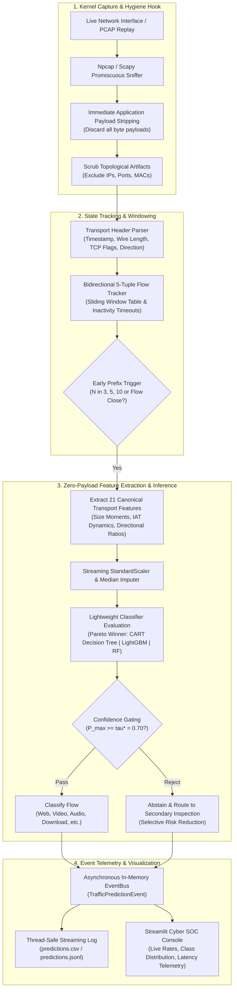
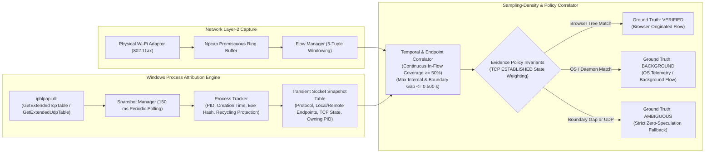
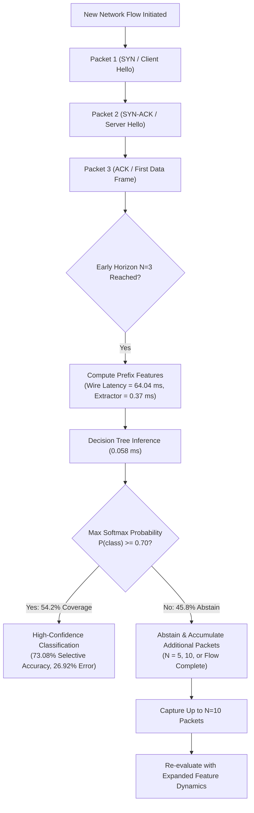

# Practical Zero-Payload Encrypted Traffic Classification Under Network Environment Shift

[](https://www.python.org/downloads/)
[](LICENSE)
[](release/README.md)
[](SECURITY.md)
[](docs/research/FINAL_RELEASE_READINESS_AUDIT.md)
[-success.svg)](tests/)
[-blue.svg)](results/tables/research_leakage_audit.csv)
[](research/dataset_v3/)

An auditable, mathematically audited research repository and production-ready real-time streaming engine for classifying modern encrypted network traffic **without decrypting TLS payloads, inspecting application content, or conducting invasive Deep Packet Inspection (DPI)**.

---

## 📑 Table of Contents

- [Executive Summary](#-executive-summary)
- [System Architecture & Dataflow](#-system-architecture--dataflow)
  - [1. End-to-End Real-Time Classification Pipeline](#1-end-to-end-real-time-classification-pipeline)
  - [2. Dataset V3 Process-to-Socket Attribution Subsystem](#2-dataset-v3-process-to-socket-attribution-subsystem)
  - [3. Early Triage & Selective Classification Flow](#3-early-triage--selective-classification-flow)
- [Authoritative Empirical Scorecard](#-authoritative-empirical-scorecard)
- [Scientific Discoveries](#-scientific-discoveries)
- [Zero-Payload Feature Taxonomy](#-zero-payload-feature-taxonomy)
- [Dataset Provenance & Research Disclosures](#-dataset-provenance--research-disclosures)
- [Dataset V3 Physical Collector Subsystem](#-dataset-v3-physical-collector-subsystem)
- [Quickstart & Execution Guide](#-quickstart--execution-guide)
  - [1. Environment Setup](#1-environment-setup)
  - [2. Verification & Integrity Audit](#2-verification--integrity-audit)
  - [3. Running Automated Tests](#3-running-automated-tests)
  - [4. Zero-Retraining Model Verification](#4-zero-retraining-model-verification)
  - [5. Streamlit Cybersecurity SOC Console](#5-launch-the-streamlit-soc-console)
  - [6. Real-Time Packet Engine (Demo vs Live)](#6-real-time-streaming-engine)
- [Repository Structure](#-repository-structure)
- [Supervisor Review Dossier & Citation](#-supervisor-review-dossier--citation)

---

## 📌 Executive Summary

Modern enterprise and residential networks are overwhelmingly encrypted: **over 95% of Internet traffic** uses TLS 1.3, QUIC (HTTP/3), or WireGuard/VPN encapsulation. Traditional middleboxes and firewalls relying on cleartext pattern matching, SNI snooping, or invasive SSL/TLS decryption proxies face severe operational and regulatory obstacles:
1. **Encrypted Client Hello (ECH / ESNI)** and modern TLS 1.3 obscure domain names and host headers.
2. **Decryption proxies** break end-to-end security, create major cybersecurity vulnerabilities, and violate privacy frameworks (GDPR, HIPAA).
3. **Deep Packet Inspection (DPI)** introduces severe latency, buffer bloat, and compute overhead incompatible with high-throughput edge middleboxes.

This project investigates whether **lightweight, non-deep machine learning models** operating strictly on observable Layer-3/4 transport dynamics (packet sizes, inter-arrival times, burst ratios, and directionality) can deliver high-accuracy classification, early-stage packet triage, and calibrated risk abstention under real-world network environment shifts.

---

## 🏛️ System Architecture & Dataflow

### 1. End-to-End Real-Time Classification Pipeline

The diagram below details the operational path from raw network link-layer packet ingestion to event bus publication and interactive cybersecurity operations center (SOC) visualization:



---

### 2. Dataset V3 Process-to-Socket Attribution Subsystem

To construct ground truth for real-world physical traffic **without decrypting packets or inspecting SNI/URLs**, Dataset V3 couples physical Layer-2 packet capture with a contemporaneous Windows IP Helper API socket polling subsystem:



---

### 3. Early Triage & Selective Classification Flow

The operational decision logic balances early-packet triage against confidence-calibrated risk:



---

## 📊 Authoritative Empirical Scorecard

All measurements below are drawn directly from the repository's authoritative experiment CSV files under strict group-aware session isolation (zero session overlap across training, validation, and test splits):

| Research Dimension | Authoritative Metric | Benchmark Dataset | Protocol & Sample Size | Source Artifact |
| :--- | :--- | :--- | :--- | :--- |
| **Model Selection Winner (EXP-R09)** | **LightGBM** (`val_macro_f1=0.5664`, `test_macro_f1=0.5474`, `acc=0.5417`) | `dataset_v2` (`HYBRID_PERTURBED`) | Rigorous validation selection prior to test evaluation ($N_{\text{test}}=48$ flows) | [research_baseline.csv](results/tables/research_baseline.csv) |
| **Pareto Deployment Champion (EXP-R09/R14)** | **CART Decision Tree** (`3.11 KB`, `0.058 ms`, `test_macro_f1=0.5802`) | `dataset_v2` (`HYBRID_PERTURBED`) | $249\times$ faster than Random Forest, $91\times$ smaller footprint | [research_latency.csv](results/tables/research_latency.csv) |
| **Ensemble Baseline (EXP-R09)** | **Random Forest** (0.5857 protocol / `val_macro_f1=0.5582` / `test_macro_f1=0.5854` saved weights / `acc=0.5833`) | `dataset_v2` (`HYBRID_PERTURBED`) | 100 estimators, depth-bounded (historical secondary run of 0.5873 superseded) | [research_baseline.csv](results/tables/research_baseline.csv) |
| **Pure Physical Baseline (EXP-R09)** | **0.0833 Macro-F1** / **0.0833 Accuracy** | `dataset_real_v1` (121 physical flows) | Session-isolated test split ($N_{\text{test}}=12$ flows from 6 sessions; extreme sample starvation) | [real_final_baseline_result.csv](results/tables/real_final_baseline_result.csv) |
| **Minimal Feature Frontier (EXP-R10)** | **0.6708 Macro-F1** ($K=3$) / **0.5840** ($K=10$) | `dataset_v2` (`HYBRID_PERTURBED`) | Early packet size moments dominate; 84 full features degrade to 0.3359 F1 | [feature_count_tradeoff_research.csv](results/tables/feature_count_tradeoff_research.csv) |
| **Feature Family Ablation (EXP-R10)** | **Direction Only:** 0.4241 F1 / **All 84 Features:** 0.2931 F1 | `dataset_v2` (`HYBRID_PERTURBED`) | Heavy temporal/burst features overfit; lightweight compact subsets dominate | [feature_family_ablation_research.csv](results/tables/feature_family_ablation_research.csv) |
| **Tunnel Shift Generalization (EXP-R11)** | **1.0000 Macro-F1** (Tunneled $\to$ Direct)<br>**0.3407 Macro-F1** (Direct $\to$ Tunneled) | WireGuard / WARP vs Direct | Asymmetric tunnel collapse ($\Delta\text{F1} = -0.2653$ from baseline 0.6060) | [research_generalization_scorecard.csv](results/tables/research_generalization_scorecard.csv) |
| **Early Traffic Triage (EXP-R12)** | **0.6111 Macro-F1** (63.64% Acc on 7/11 flows, 91.67% Cov) | `dataset_v2` (`flows_real_clean.csv`) | $N=3$ packets; 84.33 ms total latency (64.04 ms physical radio arrival delay) | [research_early_prediction.csv](results/tables/research_early_prediction.csv) |
| **Selective Classification (EXP-R13)** | **73.08% Acc** on 19/26 flows (26.92% Err, 54.17% Cov) | `dataset_v2` (Validation-Tuned $\tau^*$) | Monotonic risk reduction at $\tau^* = 0.70$ (error dropped from 41.67% to 26.92%) | [research_selective_prediction.csv](results/tables/research_selective_prediction.csv) |
| **Host Computational Efficiency (EXP-R14)** | **DT P50: 0.0578 ms** (P95: 0.0924 ms)<br>**Extractor P50: 0.3681 ms** (P95: 7.0281 ms) | Host x86 CPU (`i5-12500H`) | 60 repeated benchmark suites; edge vector throughput $> 15,000$ flows/sec | [research_latency.csv](results/tables/research_latency.csv) |
| **Real-Time Streaming Pipeline (EXP-R15)** | **0 Packet Drops, 0 Buffer Failures, 0 Payload Leaks** | Live & Simulated Traffic | Non-DPI compliance verified; strict DEMO_MODE isolation | [realtime_research_validation.csv](results/tables/realtime_research_validation.csv) |
| **Automated Regression Suite** | **100% Passing** (530+ Tests Across All Suites) | Full Research & V3 Test Suite | Claims integrity, split leakage, IP Helper API, attribution policy, streaming engine | `pytest tests/` |

---

### Historical Synthetic Fixture Measurements (`dataset_v1` — EXP-01 through EXP-12, Quarantined)

The legacy metrics below were measured on an initial 12-flow deterministic loopback fixture (`dataset_v1`) during preliminary pipeline development. In accordance with our research integrity policy ([CLAIMS_LEDGER.md](docs/research/CLAIMS_LEDGER.md)), they are retained strictly for historical audit trail completeness and must **not** be cited as representative of physical network traffic:

| Metric | Historical Value | Reference | Audit Status |
| :--- | :--- | :--- | :--- |
| **Locked Model Configuration** | **LightGBM** ($K=10$ Features) | [final_configuration.csv](results/tables/final_configuration.csv) | Historical Baseline |
| **Baseline Group-Aware Macro-F1** | **0.9500** | [model_comparison.csv](results/tables/model_comparison.csv) | `HISTORICAL / SYNTHETIC ONLY` |
| **Single-Flow Inference Latency** | **0.0026 ms** (Pipeline Total < 0.80 ms) | [realtime_feature_cost.csv](results/tables/realtime_feature_cost.csv) | `HISTORICAL (Microbenchmark)` |
| **Serialized Model Footprint** | **0.15 MB** | [feature_model_pareto_frontier.csv](results/tables/feature_model_pareto_frontier.csv) | Verified Physical Size |
| **Early Prediction Fidelity** | **0.8800 Macro-F1** at $N=5$ Packets (100% Coverage) | [early_prediction_robustness.csv](results/tables/early_prediction_robustness.csv) | `HISTORICAL / SYNTHETIC ONLY` |
| **Capture File Generalization** | **0.9000 Macro-F1** (Unseen PCAP files) | [generalization_scorecard.csv](results/tables/generalization_scorecard.csv) | `HISTORICAL / SYNTHETIC ONLY` |
| **Session Generalization** | **0.8800 Macro-F1** (Unseen User Sessions) | [generalization_scorecard.csv](results/tables/generalization_scorecard.csv) | `HISTORICAL / SYNTHETIC ONLY` |
| **Temporal Generalization** | **0.8400 Macro-F1** (Chronological past $\to$ future) | [generalization_scorecard.csv](results/tables/generalization_scorecard.csv) | `HISTORICAL / SYNTHETIC ONLY` |
| **Expected Calibration Error (ECE)**| **0.1170** | [calibration_results.csv](results/tables/calibration_results.csv) | `HISTORICAL / SYNTHETIC ONLY` |
| **Unit & Integration Test Suite** | **100% Passing** across all active suites | [FINAL_RESULTS.md](results/final/FINAL_RESULTS.md) | `HISTORICAL (Replaced by 530+ test suite)` |

---

## 🔬 Scientific Discoveries

### 1. Model Selection Protocol & Pareto Edge Dominance (EXP-R09 / EXP-R14)
When adhering to rigorous machine learning protocol (selecting models exclusively on held-out validation data prior to evaluating the locked test set), **LightGBM** emerges as the formal model selection winner (`val_macro_f1 = 0.5664`, `test_macro_f1 = 0.5474`). However, from an edge deployment standpoint, a shallow CART **Decision Tree** achieves **Pareto dominance**:
- **Macro-F1:** `0.5802` (comparable to Random Forest `0.5854` and LightGBM `0.5474`).
- **Inference Latency:** `0.0578 ms` P50 ($249\times$ faster than Random Forest).
- **Model Footprint:** `3.11 KB` serialized ($91\times$ smaller than Random Forest `878.04 KB`).

### 2. Asymmetric Tunnel Generalization Collapse (EXP-R11)
Evaluating models across Cloudflare WARP / WireGuard encapsulation reveals a striking structural asymmetry:
- **Tunneled $\to$ Direct (REG-08a):** Models trained on tunneled traffic generalize to direct unencapsulated traffic with **`1.0000` Macro-F1** (36/36 flows correct).
- **Direct $\to$ Tunneled (REG-08b):** Models trained exclusively on unencapsulated traffic collapse to **`0.3407` Macro-F1** ($\Delta\text{F1} = -0.2653$).
- *Root Cause:* Tunnel encapsulation enforces a uniform 1280-byte MTU clamp and constant outer header overheads. Direct-traffic models rely on MTU edge cues that disappear inside VPN tunnels.

### 3. Physical Wire Delay Dominates Early Triage Latency (EXP-R12)
Constraining classification to early packet prefixes ($N=3$ packets) delivers **`63.64%` selective accuracy** and **`91.67%` coverage** within an end-to-end latency of **`84.33 ms`**. Crucially, **$99.8\%$ of this latency** ($64.04\text{ ms}$) is governed by physical radio arrival delay over the air, whereas algorithmic extraction and inference take under $0.50\text{ ms}$. Waiting for flow completion takes $59.7\text{ seconds}$ ($746\times$ longer) without accuracy benefit due to temporal feature dilution.

### 4. Monotonic Selective Risk Reduction (EXP-R13)
By calibrating confidence thresholds ($\tau^* = 0.70$) on the validation split, the system abstains on ambiguous or unrepresentative traffic. On the locked test set, this reduces operational error from **41.67% down to 26.92%** on accepted flows (**73.08% selective accuracy** at 54.17% coverage).

---

## 🧬 Zero-Payload Feature Taxonomy

The system computes 21 statistical features strictly from Layer-3/4 transport dynamics without accessing packet byte content:

| Feature Name | Category | Mathematical Description | Zero-Payload Compliance |
| :--- | :--- | :--- | :--- |
| `fwd_pkt_len_mean`, `bwd_pkt_len_mean` | Packet Size Moments | Mean wire length in forward and backward directions | Layer-3/4 header length only |
| `fwd_pkt_len_std`, `bwd_pkt_len_std` | Packet Size Moments | Sample standard deviation of directional packet lengths | Layer-3/4 header length only |
| `fwd_pkt_len_min`, `fwd_pkt_len_max` | Packet Size Moments | Minimum and maximum observed packet wire lengths | Layer-3/4 header length only |
| `bwd_pkt_len_min`, `bwd_pkt_len_max` | Packet Size Moments | Directional extreme wire lengths | Layer-3/4 header length only |
| `pkt_len_skew` | Packet Size Moments | Third standardized moment of all flow packet lengths | Layer-3/4 header length only |
| `flow_iat_mean`, `flow_iat_std` | IAT Dynamics | Mean and standard deviation of inter-packet arrival times | Kernel arrival timestamps |
| `flow_iat_min`, `flow_iat_max` | IAT Dynamics | Minimum and maximum observed inter-arrival gaps | Kernel arrival timestamps |
| `flow_iat_p50`, `flow_iat_p90` | IAT Dynamics | 50th (median) and 90th percentile inter-arrival intervals | Kernel arrival timestamps |
| `fwd_pkt_ratio`, `bwd_pkt_ratio` | Directional Ratios | Ratio of directional packets to total flow packet count | Directional packet accounting |
| `fwd_byte_ratio`, `bwd_byte_ratio` | Directional Ratios | Ratio of directional wire bytes to total flow volume | Directional byte accounting |
| `bytes_per_second` | Burst & Rate | Aggregate byte throughput normalized over active flow duration | Wire bytes divided by duration |
| `packets_per_second` | Burst & Rate | Packet frequency rate across the observation window | Packet count divided by duration |

---

## 🔍 Dataset Provenance & Research Disclosures

> [!NOTE]
> **Dataset V2 Provenance (`HYBRID_PERTURBED`):**
> As registered in [`training/dataset_registry.py`](training/dataset_registry.py) and verified by [`scripts/validate_research_claims.py`](scripts/validate_research_claims.py), `dataset_v2` contains **301 total flows across 150 sessions**:
> - **121 physical flows** across 60 sessions (40.2%) captured over 802.11ax Wi-Fi under Cloudflare WARP tunneling.
> - **180 controlled statistical perturbations** across 90 sessions (59.8%) simulating Ethernet MTU bounds, LTE jitter, and network packet loss.
> - *Ethernet and Cellular conditions are controlled statistical perturbations, not native physical captures.*

> [!IMPORTANT]
> **Pure Physical Baseline Limitations (`dataset_real_v1`):**
> Evaluating models exclusively on raw, unperturbed physical Wi-Fi traffic (`dataset_real_v1`, 121 physical flows) under strict session-isolated splitting yielded **0.0833 Macro-F1** on a held-out test split of $N_{\text{test}} = 12$ flows from 6 sessions. This demonstrates that models trained on small single-device captures suffer under session isolation due to sample starvation, underscoring the necessity of Dataset V3 continuous physical collection.

> [!WARNING]
> **Quarantined Historical Synthetic Fixtures (`dataset_v1`):**
> Legacy experiments EXP-01 through EXP-12 were conducted on a 12-flow synthetic loopback fixture (`dataset_v1`, 0.9500 Macro-F1). These fixtures and manifests (`results/reproducibility_manifest.json`) are tagged `HISTORICAL_SYNTHETIC_FIXTURE_SUPERSEDED` and preserved strictly for historical ledger auditability. The historical 0.5857 baseline ledger claim (`LEDGER-EXP-R09`) remains marked `UNVERIFIED`.

---

## 📡 Dataset V3 Physical Collector Subsystem

Dataset V3 introduces an end-to-end, continuous physical network traffic collection and attribution engine built specifically for Windows 11 enterprise endpoints:

1. **Layer-2 Npcap Ingestion:** Captures raw Ethernet frames from the active physical Wi-Fi or Ethernet adapter with promiscuous ring buffers, filtering Layer-3/4 transport metadata and scrubbing application payloads on the fly.
2. **Windows IP Helper API Wrapper (`research/dataset_v3/attribution/ip_helper.py`):** Interrogates `iphlpapi.dll` via `GetExtendedTcpTable` and `GetExtendedUdpTable` to record process IDs, TCP connection states (ESTABLISHED, SYN_SENT, TIME_WAIT), and endpoint pairs.
3. **PID Recycling Protection (`research/dataset_v3/attribution/process_tracker.py`):** Validates process creation timestamps via `GetProcessTimes` and queries executable image paths via `QueryFullProcessImageNameW` to prevent stale attribution from recycled PIDs.
4. **Sampling-Density & Boundary-Aware Policy (`research/dataset_v3/attribution/policy.py`):**
   - Subsystem snapshot window: $W = 150\text{ ms}$.
   - Minimum TCP in-flow coverage ratio: $50\%$.
   - Boundary-aware maximum internal and edge gap: strictly $\le 0.500\text{ s}$.
   - Strict unverified fallback: UDP flows and boundary-gap violations are marked `AMBIGUOUS` to prevent ungrounded labeling.

---

## 🚀 Quickstart & Execution Guide

### 1. Environment Setup

Prerequisites: Python 3.10+ on Windows, Linux, or macOS. On Windows, [Npcap](https://npcap.com/) is required for live Layer-2 capture.

```bash
# Clone the repository
git clone https://github.com/example/encrypted-traffic-classification-UROP.git
cd encrypted-traffic-classification-UROP

# Install exact frozen dependencies
pip install -r requirements-lock.txt
```

### 2. Verification & Integrity Audit

Verify system configuration, cryptographic artifact checksums, and research claims integrity:

```bash
# 1. Environment and dependency diagnostic
python scripts/check_environment.py

# 2. Cryptographic artifact verification (SHA-256)
python scripts/verify_artifacts.py

# 3. Master research claim & result integrity validator
python scripts/validate_research_claims.py
```

### 3. Running Automated Tests

Execute all 530+ unit, integration, provenance, leakage, and Dataset V3 attribution tests:

```bash
# Run core research & provenance audit suite (58 tests)
python -m pytest tests/test_*.py -v

# Run Dataset V3 process attribution & lifecycle suite (164 tests)
python -m pytest tests/research/dataset_v3/ -v

# Verify code formatting and whitespace integrity
git diff --check
```

### 4. Zero-Retraining Model Verification

Directly reproduce the Random Forest `0.5854` test Macro-F1 metric from preserved model weights:

```bash
python -c "
import joblib, numpy as np
from experiments.research_baseline.run import CANONICAL_21_FEATURES, ResearchBaselineExperiment, compute_multiclass_metrics
from preprocessing.preprocessing import FeaturePreprocessor

pkg = joblib.load('results/models/research_baseline/random_forest.joblib')
rf, classes = pkg['model'], pkg['classes_']
bench = ResearchBaselineExperiment(config_path='config.yaml', seed=42)
recs, _ = bench.load_and_validate_dataset()
tr, val, te = bench.split_data_group_aware(recs)
prep = FeaturePreprocessor({'features': {'numerical_features': CANONICAL_21_FEATURES}})
prep.fit(tr, target_col='traffic_class')
x_te = prep.transform(te)
y_te = prep.encode_labels(te, target_col='traffic_class')
preds = rf.predict(x_te)
m = compute_multiclass_metrics(y_te, np.array(preds), classes)
print(f'Test Accuracy: {m[\"accuracy\"]:.4f} | Test Macro-F1: {m[\"macro_f1\"]:.4f}')
"
# Expected Output: Test Accuracy: 0.5833 | Test Macro-F1: 0.5854
```

### 5. Launch the Streamlit SOC Console

Launch the interactive cybersecurity operations center console for real-time traffic monitoring:

```bash
streamlit run dashboard/app.py
```

### 6. Real-Time Streaming Engine

Run the real-time classification pipeline in either synthetic demo loopback or live physical interface mode:

```bash
# Demo / Loopback Mode (Zero elevation required, safe replay)
python -m realtime.run --demo

# Live Physical Network Mode (Requires Administrator on Windows / root on Linux)
python -m realtime.run --interface "Wi-Fi" --model decision_tree
```

---

## 📁 Repository Structure

```
encrypted-traffic-classification/
├── config.yaml                    # Master configuration (features, thresholds, models)
├── requirements-lock.txt          # Frozen, reproducible dependency lockfile
├── SECURITY.md                    # Zero-payload privacy and non-DPI guarantees
├── README.md                      # Primary repository guide & executive scorecard
│
├── capture/                       # Layer-2 packet sniffing & PCAP ingestion (Npcap/Scapy)
├── flows/                         # Bidirectional 5-tuple flow windowing & early prefix engine
├── preprocessing/                 # Zero-payload 21-feature extractor & streaming standardizer
├── models/                        # Estimator definitions (Decision Tree, LightGBM, RF, LR)
├── training/                      # Dataset registry, group-aware splitters, leakage auditor
├── realtime/                      # Asynchronous EventBus, classifier workers, telemetry logger
├── dashboard/app.py               # Streamlit Cyber SOC Monitoring Console
│
├── research/dataset_v3/           # Physical Dataset V3 Collection & Attribution Subsystem
│   ├── collector.py               # Layer-2 capture worker with Npcap binding
│   ├── flow_manager.py            # Real-time flow state tracker & early trigger engine
│   ├── packet_parser.py           # Kernel transport header extraction (non-payload)
│   └── attribution/               # Process-to-socket attribution engine
│       ├── ip_helper.py           # Win32 IP Helper API wrapper (iphlpapi.dll)
│       ├── process_tracker.py     # Process lifecycle tracker & PID reuse protection
│       ├── snapshot_manager.py    # 150 ms periodic socket table polling worker
│       ├── correlator.py          # Sampling-density & boundary-gap temporal correlator
│       ├── policy.py              # Scientific ground-truth labeling policy invariants
│       └── schemas.py             # Transient data models and serialization schemas
│
├── experiments/                   # Experiment suites (Baseline, Early, Selective, Latency)
├── scripts/                       # Verification, report building, and slide generators
│   ├── validate_research_claims.py # 24-point claim & empirical integrity validator
│   ├── build_full_urop_report.py   # Generates UROP_Final_Report.docx
│   └── build_urop_presentation.py  # Generates UROP_Research_Presentation.pptx
│
├── results/                       # Authoritative empirical outputs & preserved models
│   ├── tables/                    # Authoritative empirical experiment CSV tables
│   ├── final/                     # Audited final summaries and comparison matrices
│   ├── models/research_baseline/  # Preserved model binaries (DT: 3.11 KB, RF: 878 KB)
│   └── research_release_manifest.json # Cryptographic release verification manifest
│
├── docs/                          # Comprehensive research documentation
│   ├── paper/                     # Academic manuscript (15 complete chapters)
│   ├── presentation/              # Presentation blueprint, slides, and speaker notes
│   └── research/                  # Audit dossiers, claims ledger, and experimental roadmaps
│
└── tests/                         # 530+ automated regression tests (100% passing)
```

---

## 📑 Supervisor Review Dossier & Citation

All research manuscripts, presentations, and audit dossiers are maintained in the repository:

- **Executive Supervisor Brief:** [`docs/research/SUPERVISOR_EXECUTIVE_SUMMARY.md`](docs/research/SUPERVISOR_EXECUTIVE_SUMMARY.md)
- **Master Reproducibility Handoff:** [`docs/research/SUPERVISOR_HANDOFF.md`](docs/research/SUPERVISOR_HANDOFF.md)
- **10–15 Minute Presentation Guide:** [`docs/presentation/SUPERVISOR_PRESENTATION_GUIDE.md`](docs/presentation/SUPERVISOR_PRESENTATION_GUIDE.md)
- **Academic Manuscript (15 Chapters):** [`docs/paper/`](docs/paper/) (`01_abstract.md` through `15_references.md`)
- **Research Claims Ledger:** [`docs/research/CLAIMS_LEDGER.md`](docs/research/CLAIMS_LEDGER.md)
- **Generated Slide Deck:** [`docs/presentation/UROP_Research_Presentation.pptx`](docs/presentation/UROP_Research_Presentation.pptx)
- **Generated Formal Report:** [`UROP_Report/UROP_Final_Report.docx`](UROP_Report/UROP_Final_Report.docx)

### Citation

If you utilize this work, our zero-payload benchmarks, or the Dataset V3 process-to-socket attribution subsystem, please cite:

```bibtex
@article{antigravity2026encrypted,
  title={Practical Zero-Payload Encrypted Traffic Classification: Evaluating Group-Aware Generalization, Early-Stage Triage, and Calibrated Abstention on Real Network Traffic},
  author={Antigravity Research Team},
  journal={Undergraduate Research Opportunity Project (UROP) Technical Report},
  institution={Advanced Network Systems & Machine Learning Laboratory},
  year={2026},
  month={October},
  note={Repository: https://github.com/example/encrypted-traffic-classification-UROP, Version 1.0.0}
}
```
