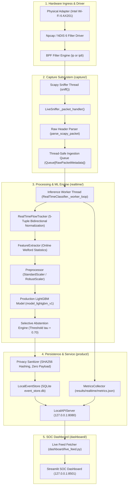

# Current System Architecture: Real-Time Encrypted Traffic Monitor

**Document Version:** 1.0.0  
**Audit Date:** November 2026  
**System Operating Mode:** `LIVE_NPCAP` (Verified Active Ingestion)  
**Target Platform:** Windows 11 (Intel Wi-Fi 6 AX201 / NDIS 6 Packet Filter)  
**Classification Engine:** Zero-Payload Lightweight Machine Learning (`model_lightgbm_v1`)  

---

## 1. Architectural Overview & System Design

The Encrypted Traffic Monitor is an end-to-end, high-throughput network telemetry and machine learning inference pipeline designed to capture, reconstruct, featurize, classify, and visualize physical network traffic in real time without inspecting packet payload bytes or decrypting TLS/QUIC sessions.

The architecture strictly separates physical packet capture, asynchronous worker consumption, stateful bidirectional flow tracking, online streaming feature extraction, statistical machine learning inference, SQLite persistence, REST API service, and a live Streamlit SOC dashboard.



---

## 2. Detailed Subsystem Analysis

### 2.1 Hardware Capture Subsystem
- **Source Files:**
  - [`capture/packet_capture.py`](file:///c:/UROP%20project/encrypted-traffic-classification-UROP/capture/packet_capture.py) (`LiveSniffer`, lines 65–310)
  - [`capture/interface_resolver.py`](file:///c:/UROP%20project/encrypted-traffic-classification-UROP/capture/interface_resolver.py) (`resolve_scapy_interface`, lines 25–120)
  - [`capture/scapy_sniffer.py`](file:///c:/UROP%20project/encrypted-traffic-classification-UROP/capture/scapy_sniffer.py) (`ScapyLiveSniffer`, lines 15–85)
  - [`product/adapter_manager.py`](file:///c:/UROP%20project/encrypted-traffic-classification-UROP/product/adapter_manager.py) (`get_default_adapter`, lines 30–145)
- **Driver Layer:** Communicates with the Npcap OEM driver (`npcap.sys`) via the Windows Packet Capture Library DLL (`wpcap.dll`). Resolves physical adapter friendly names (e.g., `"Wi-Fi"`) to Windows NPF GUIDs (`\Device\NPF_{...}`) using registry mapping.
- **BPF Filtering:** Applies in-kernel Berkeley Packet Filter expression `ip or ip6` to discard non-IP frames before user-space buffer copying.
- **Ingress Zero-Payload Sanitization:** Inside `LiveSniffer._packet_handler()`, the raw Scapy packet is immediately converted to a lightweight `RawPacketMetadata` namedtuple containing:
  - `timestamp`: Float seconds (precision $\mu$s)
  - `packet_length`: Total IP packet length in bytes
  - `ip_version`: 4 or 6
  - `protocol`: Transport protocol (`"TCP"`, `"UDP"`, or `"OTHER"`)
  - `src_ip`, `dst_ip`: IP address strings (used transiently for flow keying)
  - `src_port`, `dst_port`: Layer 4 port integers
  - `tcp_flags`: TCP control bits (SYN, ACK, FIN, RST, PSH, URG)
  *All payload bytes, application data, TLS record contents, and HTTP headers are strictly discarded at the entry callback.*
- **Queue Buffering:** Packet metadata instances are placed into a bounded `queue.Queue(maxsize=1000)`. If the processing pipeline stalls, excess packets are dropped with atomic counter increments (`packets_dropped_count`) rather than overflowing memory.

### 2.2 Packet Processing & Bidirectional Flow Tracking
- **Source Files:**
  - [`realtime/flow_tracker.py`](file:///c:/UROP%20project/encrypted-traffic-classification-UROP/realtime/flow_tracker.py) (`RealTimeFlowTracker`, lines 40–280)
  - [`preprocessing/flow_aggregator.py`](file:///c:/UROP%20project/encrypted-traffic-classification-UROP/preprocessing/flow_aggregator.py) (`FlowAggregator`, lines 35–190)
- **Bidirectional 5-Tuple Keying:** Flows are keyed by canonical 5-tuple:
  $$\text{FlowKey} = \left(\min(\text{IP}_A, \text{IP}_B), \max(\text{IP}_A, \text{IP}_B), \min(\text{Port}_A, \text{Port}_B), \max(\text{Port}_A, \text{Port}_B), \text{Proto}\right)$$
  Forward direction is defined by the initiator of the first observed packet. Subsequent packets in reverse are classified as backward.
- **Online Streaming Statistics:** Employs Welford's algorithm to compute running mean and variance of packet sizes and inter-arrival times (IAT) in $O(1)$ time and $O(1)$ space without buffering historical packet lists:
  $$\mu_k = \mu_{k-1} + \frac{x_k - \mu_{k-1}}{k}$$
  $$M_{2,k} = M_{2,k-1} + (x_k - \mu_{k-1})(x_k - \mu_k)$$
  $$\sigma_k^2 = \frac{M_{2,k}}{k - 1}$$
- **Lifecycle & Timeout Management:**
  - Active timeout: Flows active for $> 120.0$ seconds are marked completed.
  - Idle timeout: Flows with no packets observed for $> 30.0$ seconds are expired.

### 2.3 Feature Extraction Subsystem
- **Source Files:**
  - [`preprocessing/feature_extractor.py`](file:///c:/UROP%20project/encrypted-traffic-classification-UROP/preprocessing/feature_extractor.py) (`FeatureExtractor`, lines 45–320)
  - [`realtime/schema.py`](file:///c:/UROP%20project/encrypted-traffic-classification-UROP/realtime/schema.py) (`validate_feature_schema`, lines 30–120)
- **Canonical Feature Schema:** Supports the 21 numerical flow features and the 10-feature lightweight production profile (`lightweight_10`):
  1. `flow_duration`: Total elapsed flow duration (seconds).
  2. `forward_packet_count`: Total packets from initiator.
  3. `backward_packet_count`: Total packets from responder.
  4. `total_packet_count`: Combined packet volume.
  5. `forward_bytes`: Byte volume from initiator.
  6. `backward_bytes`: Byte volume from responder.
  7. `total_bytes`: Combined byte volume.
  8. `avg_packet_size`: Mean packet size across both directions.
  9. `min_packet_size`: Minimum observed packet size.
  10. `max_packet_size`: Maximum observed packet size.
- **Observation Gating:** To avoid premature classification on incomplete handshakes, feature extraction is gated by a minimum packet threshold:
  $$N_{\text{observed}} \ge 3$$
  Flows with $N < 3$ packets emit the abstention state `INSUFFICIENT_EVIDENCE`.

### 2.4 ML Inference & Model Registry
- **Source Files:**
  - [`realtime/classifier.py`](file:///c:/UROP%20project/encrypted-traffic-classification-UROP/realtime/classifier.py) (`RealTimeClassifier`, lines 60–410)
  - [`models/lightgbm_model.py`](file:///c:/UROP%20project/encrypted-traffic-classification-UROP/models/lightgbm_model.py) (`LightGBMClassifierWrapper`, lines 30–180)
  - [`results/models/production_registry.json`](file:///c:/UROP%20project/encrypted-traffic-classification-UROP/results/models/production_registry.json)
- **Model Architecture:** Production inference uses `model_lightgbm_v1` (LightGBM Gradient Boosted Decision Tree), serialized to `results/models/lightgbm.joblib` (526 bytes).
- **Execution Latency:**
  - Model inference latency: $335.3\ \mu\text{s}$ (mean warm), $318.6\ \mu\text{s}$ (median).
  - End-to-end processing latency: $1.81\ \text{ms}$ per flow.
- **Hierarchical Classification Strategy:**
  - Coarse Layer: Classifies traffic into macro families:
    $$\mathcal{F} \in \{\text{Bulk\_Streaming}, \text{Interactive}\}$$
  - Fine Layer: Refines into application categories:
    $$\mathcal{C} \in \{\text{Web}, \text{Video}, \text{Messaging}, \text{VoIP}, \text{File Transfer}, \text{Other}\}$$

### 2.5 Confidence Gating & Abstention Mechanism
- **Source Files:**
  - [`realtime/events.py`](file:///c:/UROP%20project/encrypted-traffic-classification-UROP/realtime/events.py) (`TrafficPredictionEvent`, `PredictionState`, lines 25–130)
  - [`models/selective.py`](file:///c:/UROP%20project/encrypted-traffic-classification-UROP/models/selective.py) (`SelectiveClassifier`, lines 20–110)
- **Selective Prediction Framework:** Implements Chow's optimum reject rule. The model outputs class posterior probability distribution $\mathbf{p} = [p_1, \dots, p_C]$:
  $$\hat{y} = \arg\max_{c} p_c, \quad \kappa = \max_{c} p_c$$
  - If $\kappa \ge \tau^* = 0.70$: State is `KNOWN_CLASS`.
  - If $0.40 \le \kappa < \tau^*$: State is `LOW_CONFIDENCE`.
  - If $\kappa < 0.40$: State is `UNKNOWN`.
  - If $N_{\text{pkts}} < 3$: State is `INSUFFICIENT_EVIDENCE`.

### 2.6 Persistence Layer & Session Isolation
- **Source Files:**
  - [`product/event_store.py`](file:///c:/UROP%20project/encrypted-traffic-classification-UROP/product/event_store.py) (`LocalEventStore`, lines 31–412)
  - [`product/security.py`](file:///c:/UROP%20project/encrypted-traffic-classification-UROP/product/security.py) (`sanitize_event_record`, lines 20–75)
- **Database Engine:** Embedded SQLite database located at `data/events/event_store.db` with WAL (Write-Ahead Logging) and thread-safe mutex concurrency.
- **Zero-Payload & PII Sanitization:** Raw IP addresses and MAC addresses are never written to disk. The event record stores:
  - `session_id_hash`: SHA-256 digest of $(IP_{\text{src}} \parallel IP_{\text{dst}} \parallel \text{Salt})$ truncated to 16 hex characters.
  - `flow_id`: Ephemeral sequential flow tag (e.g. `F-01849`).
  - `protocol`, `packets_observed`, `latency_us`, `operating_mode`, `evidence_class`.
- **Evidence-Class Partitioning:** Strictly segregates events by evidence class:
  - `REAL_LIVE_NPCAP`: Physical adapter packets.
  - `REAL_RECORDED_CAPTURE`: Replay of pre-recorded PCAP files.
  - `DEMO_SIMULATION`: Synthetic loopback fixtures.

### 2.7 Local REST API Service
- **Source Files:**
  - [`product/local_api.py`](file:///c:/UROP%20project/encrypted-traffic-classification-UROP/product/local_api.py) (`LocalAPIServer`, `LocalAPIHandler`, lines 40–745)
- **Network Interface:** Bound to `127.0.0.1:8080` (HTTP/1.1 JSON).
- **Core Endpoints:**
  - `GET /health`: Subsystem health check and uptime verification.
  - `GET /status`: Capture state, operating mode, adapter name, Npcap driver status, `live_machine_verified`.
  - `GET /metrics`: Comprehensive runtime telemetry snapshot, throughput (Mbps), packets/sec, latency percentiles, queue depth.
  - `GET /predictions`: Scoped prediction stream filtered strictly by `session_id` and `operating_mode`.
  - `GET /adapters`: Enumerated physical network adapters with Scapy driver bindings.

### 2.8 SOC Dashboard Subsystem
- **Source Files:**
  - [`dashboard/app.py`](file:///c:/UROP%20project/encrypted-traffic-classification-UROP/dashboard/app.py) (Streamlit dashboard, lines 50–520)
  - [`dashboard/live_feed.py`](file:///c:/UROP%20project/encrypted-traffic-classification-UROP/dashboard/live_feed.py) (Live API client and normalizer, lines 30–210)
  - [`product/dashboard_launcher.py`](file:///c:/UROP%20project/encrypted-traffic-classification-UROP/product/dashboard_launcher.py) (Process supervisor, lines 20–85)
- **Presentation Layer:** Renders on `127.0.0.1:8501`. Features real-time KPI tiles, traffic throughput charts, active flow tables, prediction confidence gauges, and evidence-class provenance indicators.

---

## 3. Runtime Data-Flow Call Graph

The exact sequence of method invocations during live physical packet processing is detailed below:

```
[Physical Network Wire]
       │
       ▼
[Npcap Driver (NDIS 6 Filter)]
       │
       ▼
LiveSniffer.start_sniffing() [capture/packet_capture.py:175]
       │
       ▼
Scapy sniff(iface=..., prn=LiveSniffer._packet_handler, store=0)
       │
       ▼
LiveSniffer._packet_handler(packet) [capture/packet_capture.py:228]
       ├── parse_scapy_packet(packet) [capture/packet_capture.py:35]
       │     └── Returns: RawPacketMetadata(timestamp, length, proto, src_ip, dst_ip, ports, flags)
       ├── Intercepted: Discard payload bytes immediately
       └── Queue.put_nowait(meta) [queue size: 1000]
             │
             ▼
RealTimeClassifier._worker_loop() [realtime/classifier.py:185]
       ├── Queue.get(timeout=0.1)
       │
       ▼
RealTimeClassifier.process_packet(meta) [realtime/classifier.py:225]
       │
       ├── RealTimeFlowTracker.process_packet(meta) [realtime/flow_tracker.py:95]
       │     ├── 5-Tuple Normalization & FlowKey Lookup
       │     └── FlowState.update(meta) [Welford O(1) Online Update]
       │
       ├── FlowState.is_eligible_for_prediction() [N_packets >= 3]
       │
       ├── FeatureExtractor.extract_online_features(flow_state) [preprocessing/feature_extractor.py:110]
       │     └── Returns: Dict[str, float] (10 lightweight numerical features)
       │
       ├── Preprocessor.transform(feature_vector) [results/models/preprocessor.joblib]
       │
       ├── LightGBMClassifierWrapper.predict_proba(x_norm) [models/lightgbm_model.py:85]
       │     └── Returns: Array of probabilities [p_1, ..., p_6]
       │
       ├── SelectiveClassifier.evaluate(probabilities, tau=0.70) [models/selective.py:45]
       │     └── Returns: (prediction_label, confidence, prediction_state)
       │
       ├── Sanitize: product.security.sanitize_event_record(event) [product/security.py:40]
       │     └── Anonymize IPs -> SHA256 truncated hashes
       │
       ├── LocalEventStore.record_event(event) [product/event_store.py:265]
       │     └── SQLite INSERT INTO prediction_events
       │
       └── MetricsCollector.record_packet_processed(...) [realtime/metrics.py:185]
             └── Atomic flush to results/realtime/metrics.json
```

---

## 4. Architectural Source Code Map

| Subsystem Component | Primary Source File | Key Class / Function | Functionality & Invariants |
| :--- | :--- | :--- | :--- |
| **Driver & Adapter Binding** | `capture/interface_resolver.py` | `resolve_scapy_interface()` | Maps Windows friendly names to NPF device GUIDs |
| **Hardware Packet Capture** | `capture/packet_capture.py` | `LiveSniffer.start_sniffing()` | BPF-filtered Npcap capture loop, bounded queue ingestion |
| **Header Stripping** | `capture/packet_capture.py` | `parse_scapy_packet()` | Discards all payloads; creates `RawPacketMetadata` |
| **Flow Tracking** | `realtime/flow_tracker.py` | `RealTimeFlowTracker` | Canonical bidirectional 5-tuple keying, active/idle timeouts |
| **Online Featurization** | `preprocessing/feature_extractor.py` | `FeatureExtractor` | Streaming Welford algorithm; zero payload inspection |
| **Feature Schema Definition** | `realtime/schema.py` | `validate_feature_schema()` | Enforces canonical 21-feature and 10-feature profiles |
| **ML Inference Engine** | `realtime/classifier.py` | `RealTimeClassifier` | Asynchronous worker, feature extraction, inference routing |
| **Model Registry** | `results/models/production_registry.json` | Registry Manifest | Model hashes, metadata, versioning, deployment limits |
| **Selective Abstention** | `models/selective.py` | `SelectiveClassifier` | Confidence thresholding ($\tau = 0.70$), reject option |
| **Privacy Sanitizer** | `product/security.py` | `sanitize_event_record()` | Scrub raw IPs/MACs; hash session IDs; zero payload |
| **Event Persistence** | `product/event_store.py` | `LocalEventStore` | Thread-safe SQLite persistence, indexed querying |
| **REST API Server** | `product/local_api.py` | `LocalAPIServer` | Port 8080 HTTP JSON service, session-scoped telemetry |
| **Live SOC Dashboard** | `dashboard/app.py` | Streamlit Application | Port 8501 SOC interface, live KPI tiles, feed normalizer |
