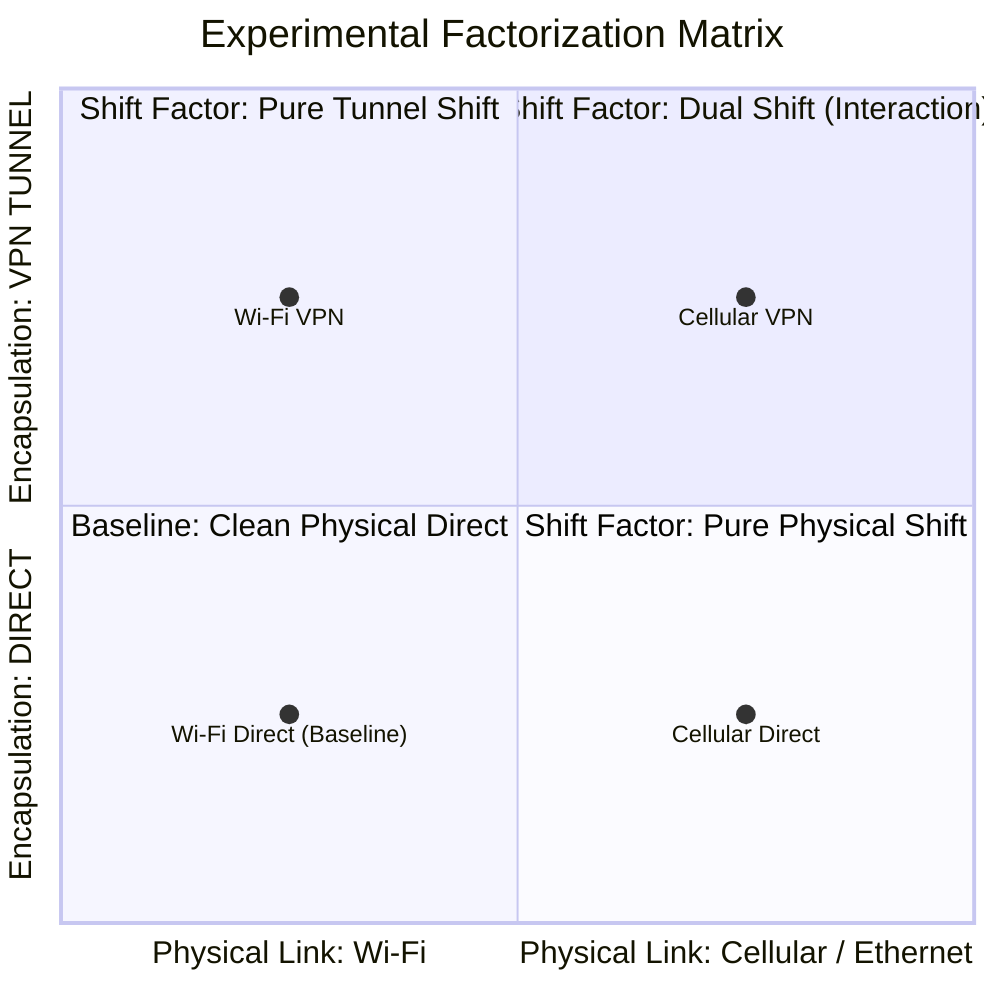
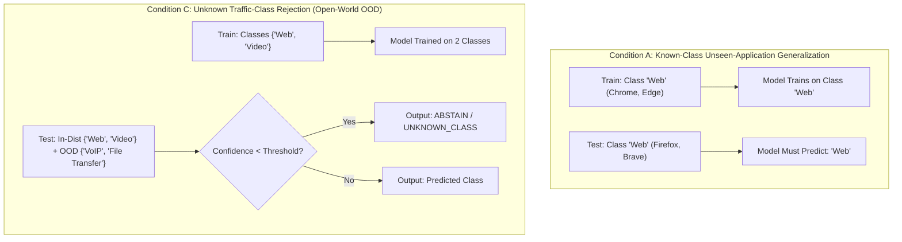

# Dataset V3 Grouping and Partitioning Specification

**Document Status**: Official Research Dataset Specification  
**Phase**: 2A.2 — Npcap Capture Backend Verification and Dataset V3 Release Gate  
**Repository**: `encrypted-traffic-classification-UROP`  
**Date**: November 2026  

---

## 1. Executive Summary & Scientific Purpose

The core research question of this project is:
> *How effectively can lightweight, zero-payload machine learning models classify encrypted traffic under network environment shift, physical device shift, and open-world distributional shifts?*

To answer this question rigorously and avoid the methodological flaws identified in Datasets V1 and V2 (synthetic perturbations without parent tracking, session confounding, and unverified splits), Dataset V3 establishes a strict, factorized grouping and partitioning framework.

This document formally specifies:
1. The **orthogonal factorization** of physical network environments vs. tunnel encapsulation states.
2. The **persistent device pseudonymization** architecture.
3. The mathematical formulation separating **Known-Class Unseen-Application Generalization** from **Unknown-Class OOD Rejection**.
4. The **complete-session discovery and duplicate-rejection invariants** implemented in `scripts/research/dataset_v3/plan_splits.py`.

---

## 2. Factorization: Physical Environment Shift vs. Tunnel Shift

In preliminary experimental proposals, the concept of "network shift" was frequently conflated into a single binary comparison (e.g. "Home Wi-Fi Direct" vs "Mobile Hotspot VPN"). 

Conflating these variables destroys causal interpretability:
* If classification accuracy drops, is it due to **physical layer characteristics** (Wi-Fi 802.11 CSMA/CA backoff, packet aggregation, RF interference)?
* Or is it due to **tunnel encapsulation** (WireGuard/OpenVPN outer encapsulation, MSS clamping to 1420 bytes, constant-rate padding, multiplexed tunnels)?

### 2.1 The Two-Factor Orthogonal Formulation
Dataset V3 enforces strict independent factorization across two dimensions in every session manifest:

#### Dimension 1: Physical Environment (`adapter_type` & `environment_id`)
* **`adapter_type`**: Restricted to `Wi-Fi`, `Ethernet`, `Cellular`.
* **`environment_id`**: A controlled categorical string identifying the physical radio/routing environment (e.g. `campus_guest_wlan`, `home_fiber_wlan`, `lte_hotspot`).
* **Physical Effects**: Packet inter-arrival times, burstiness, MAC-layer retransmissions, contention delay.

#### Dimension 2: Tunnel State (`tunnel_status`)
* **`tunnel_status`**: Restricted to `DIRECT`, `VPN`, `UNKNOWN`.
* **Encapsulation Effects**: MSS clamping (packets capped at 1380–1420 bytes instead of 1500 bytes), outer UDP/TCP encapsulation, fixed header overhead (+40–60 bytes), multi-flow multiplexing.

### 2.2 Dedicated Partitioning Functions
To isolate these causal mechanisms, `scripts/research/dataset_v3/plan_splits.py` provides separate, isolated partition algorithms:

1. **`split_physical_environment_shift(sessions)`**:
   * Evaluates physical medium invariance.
   * **Constraint**: Filters for a single fixed tunnel condition (e.g. `DIRECT`), placing one `adapter_type` (e.g. `Wi-Fi`) in Train and a distinct `adapter_type` (e.g. `Ethernet` or `Cellular`) in Test.
2. **`split_tunnel_shift(sessions)`**:
   * Evaluates encapsulation invariance.
   * **Constraint**: Holds `adapter_type` constant (e.g. `Wi-Fi`), placing `tunnel_status == "DIRECT"` in Train and `tunnel_status == "VPN"` in Test.

---

## 3. Persistent Device Pseudonym Architecture

### 3.1 Failure of Legacy Identification
Previous approaches suffered from two opposing failure modes:
1. **Privacy Violation**: Storing raw MAC addresses or machine hostnames in datasets violates privacy and IRB rules.
2. **Device Confounding**: Generating a random UUID per session prevents identifying whether two capture sessions originated from the same physical machine. This makes device-disjoint evaluation impossible.

### 3.2 Dataset V3 Solution: Local Persistent Token
Dataset V3 implements `get_or_create_device_pseudonym(state_dir)` in `research/dataset_v3/config.py`:
* **Zero PII Derivation**: The pseudonym is NOT derived from MAC addresses, CPU serials, IP addresses, or hostnames.
* **Persistent Random UUID**: On first execution, the collector generates `dev_pseudonym_<hex12>` using Python's `uuid.uuid4().hex[:12]` and persists it in `~/.dataset_v3/device_pseudonym.token` (with `0o600` permissions).
* **Cross-Session Reusability**: Subsequent sessions on the same machine read and reuse this token.
* **Cross-Machine Isolation**: A different physical machine generates its own distinct random token.

### 3.3 Device-Disjoint Splitting Guarantee
In `split_device_disjoint(sessions)`:
$$\mathcal{D}_{\text{train}} \cap \mathcal{D}_{\text{test}} = \emptyset$$
All flows from physical device $A$ are strictly confined to Train, while flows from physical device $B$ are confined to Test. Check 18 in `DatasetV3Validator` verifies that no device pseudonym appears in both partitions.

---

## 4. Formal Separation: Generalization vs. Rejection

A common source of scientific ambiguity in machine learning for network traffic is confusing **in-distribution generalization**, **cross-application generalization**, and **open-world class rejection**.

Dataset V3 formally defines and separates these three experimental paradigms:

### 4.1 Condition A: Known-Class Unseen-Application Generalization
* **Objective**: Evaluate whether statistical traffic features learn the fundamental semantic class (e.g. `Video` or `Messaging`) rather than memorizing application-specific artifacts (e.g. Netflix CDN chunk sizes or Zoom packet pacing).
* **Mathematical Invariant**:
  $$\begin{aligned}
  \mathcal{C}_{\text{train}} &= \mathcal{C}_{\text{test}} \\
  \mathcal{A}_{\text{train}} \cap \mathcal{A}_{\text{test}} &= \emptyset
  \end{aligned}$$
* **Ground-Truth Label Handling**: In `labels.csv`, ground truth is **ALWAYS the true semantic class** (e.g. `traffic_class = "Video"` for both YouTube and Vimeo).
* **Evaluation Metric**: Classification Accuracy, Macro-F1, Confusion Matrix across known classes.

### 4.2 Condition B: Unknown-Application Rejection
* **Objective**: Evaluate whether the system can identify that an observed flow belongs to an application not present in the training set, regardless of its traffic class.
* **Ground-Truth Label Handling**: Labels retain true `traffic_class` and `application_alias`; rejection scoring is performed via anomaly scores or Mahalanobis distance in feature space.

### 4.3 Condition C: Unknown Traffic-Class Rejection (Open-World OOD)
* **Objective**: Evaluate whether the selective classification mechanism safely abstains or rejects traffic belonging to a completely novel traffic class.
* **Mathematical Invariant**:
  $$\begin{aligned}
  \mathcal{C}_{\text{train}} &\subset \mathcal{C}_{\text{all}} \\
  \mathcal{C}_{\text{test\_ood}} \cap \mathcal{C}_{\text{train}} &= \emptyset
  \end{aligned}$$
  *Example*: Train on $\{\text{Web}, \text{Video}, \text{Messaging}\}$; Test on $\{\text{VoIP}, \text{File Transfer}\}$.
* **Ground-Truth Invariant**: In `labels.csv`, ground truth is **NEVER set to `"UNKNOWN"`**. Ground truth is the verified physical class (`VoIP`). The label `"UNKNOWN"` is strictly a runtime prediction or abstention state.
* **Evaluation Metric**: Area Under the ROC Curve (AUROC), Area Under Precision-Recall (AUPR), and False Positive Rate at 95% True Positive Rate (FPR95) for detecting out-of-distribution flows.

---

## 5. Complete-Session Discovery and Integrity Invariants

To guarantee that incomplete, corrupted, or duplicate sessions are never incorporated into research experiments, `scripts/research/dataset_v3/plan_splits.py` enforces five discovery rules:

1. **Staging Directory Exclusion**: Any directory beginning with a dot (`.staging/`, `.incomplete/`) is automatically ignored.
2. **Completion Marker Requirement**: A session directory is recognized **only** if the marker file `SESSION_COMPLETE` exists.
3. **Manifest Status Invariant**: The manifest inside the session must have `capture_status == "COMPLETE"`.
4. **Duplicate Session ID Detection**: If two discovered sessions share the same `session_id`, `plan_splits.py` raises an immediate `ValueError` and terminates before computing splits.
5. **Session File Integrity Verification**: Before assigning a session to a partition, its SHA-256 artifact hashes are verified against `file_integrity_hashes` in the manifest.

---

## 6. Summary of Partitioning Strategies Implemented in Dataset V3

| Strategy Function | Splitting Criterion | Research Hypothesis Evaluated | Validation Invariant |
| :--- | :--- | :--- | :--- |
| `split_session_disjoint` | Hash-based partition by `session_id` | Baseline generalization without temporal or environmental leakage | Check 14: $\mathcal{S}_{\text{train}} \cap \mathcal{S}_{\text{test}} = \emptyset$ |
| `split_device_disjoint` | Partition by `device_pseudonym` | Cross-machine transferability; invariance to hardware NIC drivers | Check 18: $\mathcal{D}_{\text{train}} \cap \mathcal{D}_{\text{test}} = \emptyset$ |
| `split_physical_environment_shift` | Partition by `adapter_type` (fixed tunnel) | Physical link-layer robustness (Wi-Fi vs Cellular vs Ethernet) | Explicit adapter isolation |
| `split_tunnel_shift` | Partition by `tunnel_status` (fixed adapter) | Robustness against encapsulation, MSS clamping, and VPN tunnels | Explicit tunnel isolation |
| `split_known_class_unseen_application` | Partition by `application_alias` | Semantic class feature robustness across unseen software | Check 19: $\mathcal{A}_{\text{train}} \cap \mathcal{A}_{\text{test}} = \emptyset$ |
| `split_unknown_class_rejection` | Partition by `traffic_class` | Selective prediction and open-world OOD rejection | $\mathcal{C}_{\text{train}} \cap \mathcal{C}_{\text{test\_ood}} = \emptyset$ |
| `split_temporal_shift` | Partition by `collection_day` | Temporal stability; resistance to time-dependent concept drift | $\mathcal{T}_{\text{train}} < \mathcal{T}_{\text{test}}$ |

---

## 7. Conclusion
Dataset V3 provides a rigorous, factorized partitioning framework that eliminates experimental confounding and supports both closed-world cross-application generalization and open-world class rejection.
