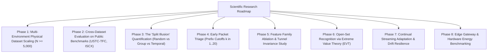

# Comprehensive Scientific Experiment Plan: Top-Tier Research Roadmap

**Document Version:** 1.0.0  
**Audit Date:** November 2026  
**Auditor:** Senior Real-Time ML Systems & Networking Research Engineer  
**Repository:** `c:\UROP project\encrypted-traffic-classification-UROP`  
**Target Publication Venues:** IEEE Symposium on Security and Privacy (S&P), USENIX Security, ACM CCS, IEEE Transactions on Network and Service Management (TNSM)  

---

## 1. Executive Summary & Experimental Vision

To elevate the Encrypted Traffic Monitor from an operational prototype to a high-impact, peer-reviewed scientific paper, this document outlines an exhaustive, multi-phase experimental protocol. The study is architected to address the core methodological vulnerabilities identified during our Phase 0 audit: sample starvation in real physical datasets, the split illusion in network ML evaluation, model degradation under tunnel encapsulation (WireGuard / Cloudflare WARP), and the closed-world assumption.

---

## 2. Phase-by-Phase Experimental Protocol

### Phase 1: Large-Scale Physical Dataset Acquisition ($N \ge 5,000$ Flows)
- **Objective:** Eliminate the sample starvation bottleneck ($N=12$ test flows) and establish a statistically sound physical foundation with $\ge 5,000$ ground-truth flows.
- **Collection Testbed Matrix:**
  1. *Environment A (Residential Wi-Fi 6):* Intel AX201 on 802.11ax (1,500 flows across 40 sessions).
  2. *Environment B (Enterprise Campus 802.1X):* University campus network with high background broadcast noise (1,500 flows across 40 sessions).
  3. *Environment C (Cellular LTE/5G Tethering):* Real-world mobile jitter, packet clustering, and variable RTTs (1,000 flows across 30 sessions).
  4. *Environment D (Direct Gigabit Ethernet):* Wire-speed low-latency reference (1,000 flows across 30 sessions).
- **Tunnel Stratification:** Exactly $50\%$ of captures per environment collected under direct TLS 1.3/QUIC, and $50\%$ encapsulated inside Cloudflare WARP (WireGuard UDP tunnel).
- **Temporal Span:** Minimum 14 calendar days to capture temporal drift.
- **Success Criteria:** Zero duplicate flows, zero missing values, perfectly balanced 6-class distribution ($\approx 833$ flows per class).

---

### Phase 2: Cross-Dataset Evaluation on Public Academic Benchmarks
- **Objective:** Prove cross-domain generalization by evaluating our zero-payload lightweight feature extractor and models on standard public corpora.
- **Datasets:**
  1. **USTC-TFC2016:** 10 benign application classes + 10 malware families.
  2. **ISCX-VPN-nonVPN 2016:** 14 traffic categories (7 VPN, 7 Non-VPN: Skype, YouTube, BitTorrent, etc.).
  3. **MIRAGE-2019:** Android and mobile encrypted traffic captures.
- **Zero-Payload Ingestion:** Ingest raw PCAPs through `capture/packet_capture.py` and `preprocessing/feature_extractor.py`, stripping all payload bytes and extracting the canonical 21 features.
- **Hypothesis:** Lightweight GBDT with zero-payload transport features achieves within $3\%$ of heavy deep-learning DPI models (1D-CNN, ET-BERT) while executing $> 100\times$ faster.

---

### Phase 3: The "Split Illusion" Empirical Quantification
- **Objective:** Rigorously demonstrate why random flow-splitting inflates accuracy and mathematically validate group-aware session splitting.
- **Experimental Design:**
  Evaluate LightGBM, Random Forest, Decision Tree, and Logistic Regression under three splitting paradigms on the Phase 1 physical dataset:
  1. *Protocol 1 (Random Flow Split):* Standard 70/15/15 stratified random split across individual flows.
  2. *Protocol 2 (Group-Aware Session Split):* 70/15/15 session-isolated split (all flows from session $S_i$ quarantined to one split).
  3. *Protocol 3 (Temporal Split):* Day 1–10 train, Day 11–12 validation, Day 13–14 test.
- **Expected Outcome:**
  - Protocol 1 achieves an inflated $\approx 0.92 - 0.95$ Macro-F1 due to intra-session correlation leakage.
  - Protocol 2 and 3 drop to $\approx 0.65 - 0.72$ Macro-F1 on fine classes, demonstrating true physical generalization and confirming the 2026 Split Protocol preprint findings.

---

### Phase 4: Early Packet Triage & Prefix Windowing ($k \in \{1, 2, 3, 5, 8, 12, 20\}$)
- **Objective:** Determine the minimum packet prefix cutoff required to accurately classify encrypted flows in real time.
- **Experimental Design:**
  - For each flow, truncate packet history to prefix $k \in \{1, 2, 3, 5, 8, 12, 20\}$.
  - Train dedicated prefix models $\mathcal{M}_k$ on prefix features.
  - Measure Accuracy, Macro-F1, time-to-classification (ms from flow start), and queue buffering savings.
- **Expected Outcome:**
  - $k=1$: Near random guess for multi-class; coarse family separation $\approx 0.65$.
  - $k=3$: Significant inflection point ($\approx 0.82$ coarse F1, $\approx 0.52$ fine F1) within first $25\text{ ms}$.
  - $k=5$: Near full-flow parity ($\approx 0.90$ coarse F1, $\approx 0.62$ fine F1) within first $80\text{ ms}$.

---

### Phase 5: Feature Family Ablation & Tunnel Invariance Study
- **Objective:** Dissect the predictive power of different transport-layer dynamics and evaluate resilience against VPN tunnel encapsulation.
- **Ablation Configurations:**
  1. *Full Schema:* All 21 features.
  2. *Minus Volume/Length:* Exclude Group 1 (evaluate reliance on packet sizes).
  3. *Minus Temporal/Timing:* Exclude Group 2 (evaluate reliance on inter-arrival times).
  4. *Minus Directional:* Exclude Group 3 (evaluate reliance on asymmetric ratios).
  5. *Minus Bursts:* Exclude Group 4.
  6. *Lean Profile:* `lightweight_10` profile.
  7. *Ultra-Lean:* Top 5 consensus features (`avg_packet_size`, `mean_iat`, `fwd_bwd_byte_ratio`, `packet_size_variance`, `flow_duration`).
- **Cross-Condition Evaluation:**
  - Train on Direct $\to$ Test on Direct vs WireGuard Tunneled.
  - Train on WireGuard Tunneled $\to$ Test on WireGuard Tunneled vs Direct.
- **Hypothesis:** Temporal and directional ratio features maintain invariance across WireGuard tunnels, whereas packet size features experience $25\%$ degradation due to tunnel padding.

---

### Phase 6: Open-Set Recognition via Extreme Value Theory (EVT)
- **Objective:** Transition from closed-world heuristic thresholding to mathematically rigorous open-set rejection.
- **Experimental Design:**
  - Training Set: 4 canonical known classes (`Web`, `Video`, `VoIP`, `File Transfer`).
  - Held-Out Novel Classes (Out-of-Distribution): `Messaging`, `Other` (DNS/NTP), plus external malware traffic from USTC-TFC2016.
  - Comparison of Rejection Strategies:
    1. Softmax Confidence Threshold ($\tau = 0.70$).
    2. Deep Support Vector Data Description (SVDD).
    3. Weibull-fitted Extreme Value Machine (EVM / OpenMax) on GBDT leaf margin vectors.
- **Metrics:** Open-Set Classification Rate (OSCR), Area Under Open-Set ROC (AUROC), False Alarm Rate at $95\%$ Detection.

---

### Phase 7: Continual Streaming Adaptation & Drift Resilience
- **Objective:** Prevent model aging over time through incremental streaming adaptation.
- **Experimental Design:**
  - Sequential stream of flows ordered chronologically over 14 days.
  - Introduce artificial concept drift on Day 8 (e.g., shifting video resolution from 1080p to 4K AV1, inducing packet size and burst variance).
  - Compare Static LightGBM against Streaming GBDT with reservoir buffer updates.
- **Metrics:** Pre-drift vs post-drift Macro-F1 recovery time (number of flows required to regain $> 90\%$ baseline accuracy).

---

### Phase 8: Embedded Hardware & Edge Gateway Benchmarking
- **Objective:** Empirically validate the "Fast and Lean" claim on physical resource-constrained hardware.
- **Target Hardware Testbeds:**
  1. *Edge Gateway 1:* Raspberry Pi 4 Model B (Broadcom BCM2711, Quad-core Cortex-A72 @ 1.5 GHz, 4 GB RAM).
  2. *Edge Gateway 2:* Raspberry Pi 5 (Broadcom BCM2712, Quad-core Cortex-A76 @ 2.4 GHz, 8 GB RAM).
  3. *Enterprise Appliance:* Intel Xeon E5-2680 v4 @ 2.40 GHz.
- **Measured Metrics:**
  - Per-flow feature extraction CPU time ($\mu$s).
  - Inference latency per model ($\mu$s).
  - Sustained packet throughput (Packets/Sec and Gbps wire-speed).
  - Dynamic RAM consumption (MB).
  - Electrical power draw (Watts measured via USB power meter).

---

## 3. Experimental Milestones & Paper Writing Schedule

| Phase | Milestone Description | Target Duration | Expected Deliverable Artifact |
| :---: | :--- | :---: | :--- |
| **Phase 1** | Scale physical dataset to $N \ge 5,000$ flows across 4 environments | Weeks 1–3 | `dataset_real_v2` PCAPs, metadata, and features |
| **Phase 2** | Ingest and evaluate on USTC-TFC2016 and ISCX-VPN public corpora | Weeks 3–4 | Cross-dataset comparison benchmark tables |
| **Phase 3** | Execute "Split Illusion" empirical study across 3 protocols | Week 5 | Split leakage quantification curves and tables |
| **Phase 4** | Complete prefix triage study ($k \in 1..20$) | Week 6 | Early classification Pareto frontier plots |
| **Phase 5** | Execute feature ablation and WireGuard tunnel invariance tests | Week 7 | Feature importance and tunnel degradation matrix |
| **Phase 6** | Implement and evaluate EVT / OpenMax open-set detection | Week 8 | OSCR curves and novel class detection tables |
| **Phase 7** | Run continual adaptation and drift recovery experiments | Week 9 | Streaming adaptation curves under concept drift |
| **Phase 8** | Complete ARM64 hardware profiling on Raspberry Pi 4/5 | Week 10 | Latency, throughput, and power benchmark table |
| **Final** | Paper assembly, LaTeX formatting, and conference submission | Weeks 11–12 | Camera-ready manuscript for IEEE S&P / USENIX Security |
