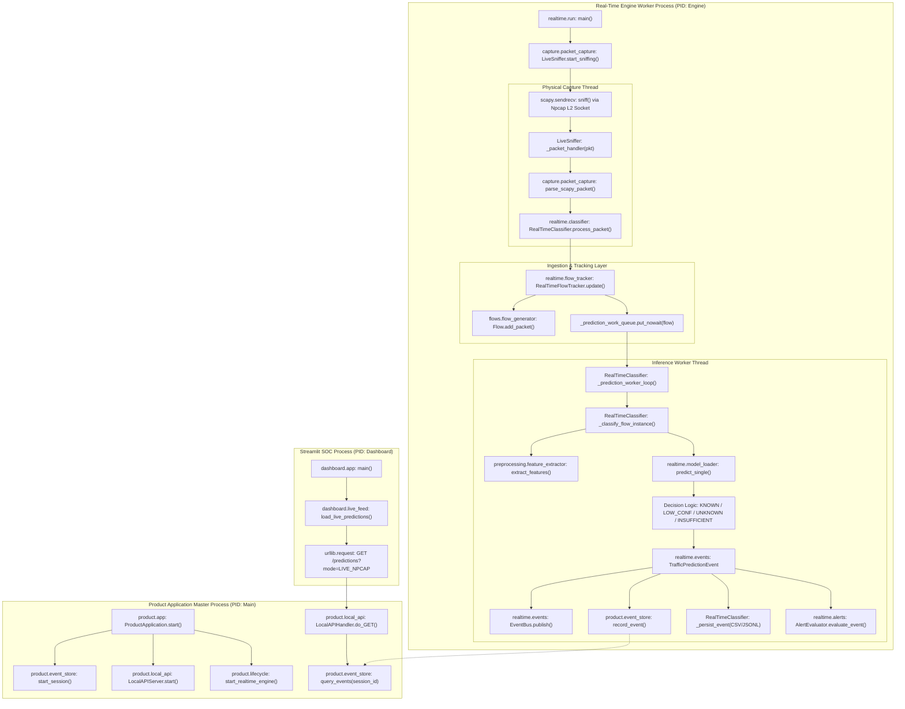

# LIVE RUNTIME CALL GRAPH & DATA-FLOW ARCHITECTURE
**Encrypted Traffic Classification — Real-Time Physical NIC Processing Pipeline**
**System Target**: Windows 11 AMD64 | Intel Wi-Fi 6 AX201 160MHz | Npcap Packet Driver
**Operating Mode**: `LIVE_NPCAP` | **Evidence Class**: `REAL_LIVE_NPCAP`

---

## 1. Executive Architecture Summary

This document traces the exact end-to-end execution flow of real physical network packets captured on a live network adapter through the encrypted traffic classification system, identifying every module, class, method, process/thread boundary, data structure, and error boundary.



---

## 2. Comprehensive Step-by-Step Runtime Call Graph

### Step 1: Orchestration & Session Initialization
- **Module**: `product.app`
- **Class**: `ProductApplication`
- **Method**: `start(mode="live", interface="Wi-Fi", model="model_lightgbm_v1")`
- **Caller**: CLI entry point `product.app:main()`
- **Callee**: 
  - `product.health:run_product_health_check()`
  - `product.security:validate_security_boundary()`
  - `product.event_store.local_event_store:start_session(session_name, operating_mode="LIVE_NPCAP")`
  - `product.local_api.LocalAPIServer:start()`
  - `product.lifecycle.ProductLifecycleManager:start_realtime_engine()`
  - `product.lifecycle.ProductLifecycleManager:start_dashboard()`
- **Thread/Process**: Master Process (`python -m product.app`), Main Thread.
- **Input**: CLI arguments (`--mode live --interface Wi-Fi`).
- **Output**: Generates authoritative `session_id` (e.g., `SESS-1795029374-6700`), starts HTTP API daemon thread on `127.0.0.1:8080`, and spawns child subprocesses.
- **Failure Behavior**: Fail-closed; aborts if Npcap driver check fails or security privacy invariants are violated.

---

### Step 2: Realtime Engine Launch & Subsystem Binding
- **Module**: `realtime.run`
- **Class**: Module-level script entry point
- **Method**: `main()`
- **Caller**: Spawned by `product.lifecycle.ProductLifecycleManager:start_realtime_engine()` as `python -m realtime.run --mode live --model lightgbm --interface Wi-Fi --session-id <session_id>`
- **Callee**:
  - `realtime.classifier.RealTimeClassifier:__init__(config_path, operating_mode="LIVE_NPCAP", session_id)`
  - `realtime.classifier.RealTimeClassifier:start()`
  - `capture.packet_capture.LiveSniffer:__init__(interface="Wi-Fi")`
  - `capture.packet_capture.LiveSniffer:start_sniffing(callback=classifier.process_packet)`
- **Thread/Process**: Child Process `realtime_engine`, Main Thread.
- **Input**: Command-line arguments containing `--mode live`, `--interface Wi-Fi`, and `--session-id`.
- **Output**: Initialized subcomponents (FlowTracker, ModelLoader, FeatureExtractor, MetricsCollector, Queues), starts background worker threads, and enters blocking capture loop.
- **Failure Behavior**: Catches SIGINT for graceful shutdown; raises `RuntimeError` if model checkpoints or registry validations fail.

---

### Step 3: Physical Capture Initialization & Npcap Adapter Binding
- **Module**: `capture.packet_capture`
- **Class**: `LiveSniffer`
- **Method**: `start_sniffing(callback, duration_seconds=None, packet_count=0)`
- **Caller**: `realtime.run:main()`
- **Callee**:
  - `capture.interface_resolver:resolve_capture_interface("Wi-Fi")`
  - `capture.packet_capture:_default_sniff(...)` -> `scapy.sendrecv:sniff()`
- **Thread/Process**: `realtime_engine` process, Main Thread (or dedicated capture thread when run asynchronously).
- **Input**: `callback=classifier.process_packet`, physical adapter identifier `Wi-Fi`.
- **Output**: Resolves friendly adapter name to Npcap device path `\Device\NPF_{B383A2A4-A634-4F0D-89E5-5A56CBCB9A0B}` and invokes Scapy sniffing loop with `prn=_packet_handler`.
- **Failure Behavior**: 
  - Raises `PermissionError` if unprivileged and Npcap requires elevation.
  - Raises `ValueError` if adapter cannot be resolved.

---

### Step 4: Physical Packet Callback & Raw Metadata Extraction
- **Module**: `capture.packet_capture`
- **Class**: `LiveSniffer` / Standalone functions
- **Method**: `LiveSniffer._packet_handler(pkt)` -> `parse_scapy_packet(pkt)`
- **Caller**: Internal Scapy dispatch thread / libpcap event loop (`scapy.sendrecv:sniff`).
- **Callee**:
  - `capture.packet_capture:parse_scapy_packet(pkt)`
  - Consumer callback `realtime.classifier.RealTimeClassifier:process_packet(metadata)`
- **Thread/Process**: Capture loop thread inside `realtime_engine`.
- **Input**: Raw packet object `pkt` from Npcap.
- **Output**: `RawPacketMetadata(timestamp, src_ip, dst_ip, src_port, dst_port, protocol, length, tcp_flags, tls_sni, tls_version, tls_cipher_suites_count, tls_extensions_count)`.
- **Failure Behavior (ROOT CAUSE OF THE OBSERVED BUG)**:
  - When `scapy.layers.l2` (`Ether`) and `scapy.layers.inet` (`IP`, `TCP`, `UDP`) were not loaded into `conf.l2types`, Scapy was unable to recognize the data-link type (`linktype=1`).
  - Scapy wrapped captured bytes into an opaque `Packet` without dissecting `IP`.
  - `parse_scapy_packet` checked `pkt.haslayer("IP")` which returned `False`, causing `parse_scapy_packet` to return `None`.
  - `_packet_handler` discarded `None`, never invoked `callback(parsed)`, and packet counters never incremented.

---

### Step 5: Packet Processing & Flow State Synchronization
- **Module**: `realtime.classifier`
- **Class**: `RealTimeClassifier`
- **Method**: `process_packet(pkt: RawPacketMetadata)`
- **Caller**: `LiveSniffer._packet_handler` via registered callback.
- **Callee**:
  - `realtime.metrics.MetricsCollector:record_packet(pkt.length)`
  - `realtime.flow_tracker.RealTimeFlowTracker:update(pkt)`
  - `queue.Queue:put_nowait(flow)` on `self._prediction_work_queue`
- **Thread/Process**: Capture callback thread.
- **Input**: `RawPacketMetadata` instance.
- **Output**: 
  - Increments `metrics_collector.live_packets_received`.
  - Updates bidirectional five-tuple flow in flow tracker.
  - If flow reaches eligibility (minimum 3 packets and interval elapsed), enqueues `Flow` into `_prediction_work_queue`.
- **Failure Behavior**: If `_prediction_work_queue` is full (`maxsize=10000`), drops prediction trigger non-blockingly, increments `dropped_packets`, and logs warning.

---

### Step 6: Bidirectional Flow Reconstruction & Lifecycle Management
- **Module**: `realtime.flow_tracker`
- **Class**: `RealTimeFlowTracker`
- **Method**: `update(pkt: RawPacketMetadata) -> Tuple[FlowKey, Flow, bool]`
- **Caller**: `RealTimeClassifier.process_packet()`
- **Callee**:
  - `flows.flow_generator.FlowKey:from_packet(pkt)`
  - `flows.flow_generator.Flow:add_packet(pkt)` or `_create_flow(key, pkt)`
  - `_notify_lifecycle(state, flow)`
- **Thread/Process**: Worker / Capture thread.
- **Input**: `RawPacketMetadata`.
- **Output**: Canonical bidirectional `FlowKey`, updated `Flow` object, and boolean flag `should_predict`.
- **Failure Behavior**: If an existing flow is idle for > 60s or active for > 1800s, it is expired and completed, and a new flow is instantiated.

---

### Step 7: Asynchronous Prediction Worker Consumption
- **Module**: `realtime.classifier`
- **Class**: `RealTimeClassifier`
- **Method**: `_prediction_worker_loop()`
- **Caller**: Executed inside `self._worker_thread` (spawned in `start()`).
- **Callee**: `self._classify_flow_instance(flow)`
- **Thread/Process**: Dedicated Daemon Thread `_worker_thread`.
- **Input**: Dequeues `Flow` object from `self._prediction_work_queue` (timeout=0.2s).
- **Output**: Calls classification pipeline for eligible flows.
- **Failure Behavior**: Catches `queue.Empty` and continues looping until `_is_running` becomes `False`.

---

### Step 8: Online Zero-Payload Feature Extraction
- **Module**: `preprocessing.feature_extractor`
- **Class**: `FeatureExtractor`
- **Method**: `extract_features(flow: Flow) -> Dict[str, Any]`
- **Caller**: `RealTimeClassifier._classify_flow_instance()`
- **Callee**: `_compute_burst_stats(timestamps, lengths)`
- **Thread/Process**: Dedicated Daemon Thread `_worker_thread`.
- **Input**: Active `Flow` containing packet timing, byte lengths, and directionality records.
- **Output**: Tabular dictionary containing canonical statistical features: `flow_duration`, `forward_packet_count`, `backward_packet_count`, `total_packet_count`, `forward_bytes`, `backward_bytes`, `total_bytes`, `avg_packet_size`, `min_packet_size`, `max_packet_size`, `packet_size_variance`, `mean_iat`, `median_iat`, `iat_std`, `min_iat`, `max_iat`, `fwd_bwd_packet_ratio`, `fwd_bwd_byte_ratio`, `burst_count`, `avg_burst_bytes`, `avg_burst_packets`, `protocol`, `dst_port`, `tls_version`, `tls_cipher_suites_count`, `tls_extensions_count`, `tls_sni_present`.
- **Failure Behavior**: Zero application payloads examined; empty flows return safe defaults without division by zero.

---

### Step 9: Feature Schema Validation & Model Inference
- **Module**: `realtime.model_loader`
- **Class**: `ModelLoader`
- **Method**: `predict_single(raw_features: Dict[str, Any]) -> Tuple[str, float, Dict[str, float]]`
- **Caller**: `RealTimeClassifier._classify_flow_instance()`
- **Callee**:
  - `realtime.schema:validate_feature_schema(raw_features)`
  - `FeaturePreprocessor:transform([raw_features])`
  - `LightGBMTrafficClassifier.model:predict_proba(x_vec)`
- **Thread/Process**: Dedicated Daemon Thread `_worker_thread`.
- **Input**: Raw statistical feature dictionary.
- **Output**: Tuple of `(pred_class, confidence, prob_map)`:
  - `pred_class`: Highest probability class name (`Web`, `Video`, `Messaging`, `VoIP`, `File Transfer`, `Other`).
  - `confidence`: Maximum class posterior probability.
  - `prob_map`: Full class posterior probability distribution dictionary.
- **Failure Behavior**: Fail-closed; raises `ValueError` if features contain NaN/Inf or if schema hash does not match production registry.

---

### Step 10: Deterministic Selective Prediction State Machine
- **Module**: `realtime.classifier`
- **Class**: `RealTimeClassifier`
- **Method**: Internal logic within `_classify_flow_instance(flow)`
- **Caller**: `RealTimeClassifier._prediction_worker_loop()`
- **Callee**: `realtime.events.TrafficPredictionEvent:__init__(...)`
- **Thread/Process**: Dedicated Daemon Thread `_worker_thread`.
- **Decision Matrix**:
  1. If `flow.total_packets < self.min_evidence_packets` (3):
     `prediction_state = INSUFFICIENT_EVIDENCE`, `confidence = None`, `pred_class = INSUFFICIENT_EVIDENCE`.
  2. If `composed_confidence < self.unknown_threshold` (0.30):
     `prediction_state = UNKNOWN`, `coarse_family = UNKNOWN`, `pred_class = UNKNOWN`.
  3. If `composed_confidence < self.confidence_threshold` (0.70):
     `prediction_state = LOW_CONFIDENCE`, `pred_class = pred_class`.
  4. Else:
     `prediction_state = KNOWN_CLASS`, `pred_class = pred_class` (must be one of 6 canonical classes).
- **Output**: Fully instantiated immutable `TrafficPredictionEvent`.
- **Failure Behavior**: Rejects any `KNOWN_CLASS` prediction lacking valid fine-grained class or family.

---

### Step 11: Multi-Sink Persistence & Event Broadcasting
- **Module**: `realtime.classifier`
- **Class**: `RealTimeClassifier`
- **Method**: `_persist_event(event)` and `local_event_store.record_event(event)`
- **Caller**: `RealTimeClassifier._classify_flow_instance()`
- **Callee**:
  - `realtime.events.EventBus:publish(event)`
  - `product.event_store.LocalEventStore:record_event(event.to_dict())`
  - `results/realtime/predictions.csv` / `predictions.jsonl` atomic appending
  - `realtime.alerts.global_alert_evaluator:evaluate_event(event)`
- **Thread/Process**: Dedicated Daemon Thread `_worker_thread`.
- **Input**: `TrafficPredictionEvent`.
- **Output**: Persisted SQLite record with indexes, JSONL row, CSV row, and in-memory event bus update.
- **Failure Behavior**: Exceptions in file I/O or SQLite are logged without crashing the worker thread.

---

### Step 12: REST API Local Serving & Session Scoping
- **Module**: `product.local_api`
- **Class**: `LocalAPIHandler`
- **Method**: `do_GET()` -> `handle_predictions(query_string)` / `handle_metrics()`
- **Caller**: Streamlit SOC Dashboard or diagnostic scripts via HTTP `GET http://127.0.0.1:8080/predictions?mode=LIVE_NPCAP&limit=100`.
- **Callee**:
  - `product.event_store.LocalEventStore:query_events(operating_mode, session_id, limit)`
  - `product.security:sanitize_event_record(ev)`
- **Thread/Process**: Local HTTP Server thread inside Master process.
- **Input**: HTTP GET request.
- **Output**: JSON payload containing `session_id`, `count`, `mode: "LIVE_NPCAP"`, `evidence_class: "REAL_LIVE_NPCAP"`, and sanitized prediction records.
- **Failure Behavior**: Returns HTTP 403 for non-localhost clients; returns HTTP 500 on unhandled exception.

---

### Step 13: Streamlit SOC Dashboard Auto-Refresh & Visual Presentation
- **Module**: `dashboard.app` & `dashboard.live_feed`
- **Class / Functions**: `load_live_predictions()` -> `normalize_api_record()` -> `render_dataframe_safe()`
- **Caller**: Streamlit runtime worker loop (`dashboard/app.py`).
- **Callee**: HTTP request to `http://127.0.0.1:8080/predictions`.
- **Thread/Process**: Dedicated Dashboard process (`python -m streamlit run dashboard/app.py`).
- **Input**: HTTP response from Local API.
- **Output**: Validates schema, formats into `CanonicalPredictionRecord`, updates KPI metrics, renders operational status badges, and renders the live real-time classification feed.
- **Failure Behavior**: If zero packets received, displays explicit state `"WAITING FOR TRAFFIC"` without synthesizing demo data or falling back to historical CSV rows.

---

## 3. The Root Cause: Why Live Packet Processing Stopped

Before this audit and repair, the live packet processing pipeline was severed at **Step 4 (`capture.packet_capture.LiveSniffer._packet_handler`)**:

1. **Scapy Layer Registration Omission**: `capture/packet_capture.py` imported Scapy's `sniff` function without importing `scapy.layers.l2` or `scapy.layers.inet`. Consequently, Scapy did not have `linktype=1` (Ethernet) registered in `conf.l2types`.
2. **Silent Packet Degradation**: When real packets arrived from the Wi-Fi physical adapter, Scapy could not dissect the datalink layer. Scapy emitted:
   `WARNING: Unable to guess datalink type (interface=\Device\NPF_{...} linktype=1). Using <member 'name' of 'Packet' objects>`
3. **Layer Detection Failure**: In `parse_scapy_packet(pkt)`, the function tested:
   ```python
   if not pkt.haslayer("IP") and not pkt.haslayer("IPv6"):
       return None
   ```
   Because `pkt` was an unparsed generic `Packet` object, `haslayer("IP")` returned `False`.
4. **Silent Dropping**: `parse_scapy_packet` returned `None`, which `LiveSniffer` silently dropped.
5. **Downstream Starvation**: The callback `classifier.process_packet` was never invoked. The queue remained empty, the flow tracker received zero packets, zero features were extracted, zero inference events were emitted, and the dashboard correctly reported:
   - `Packets Received: 0`
   - `Active Flows: 0`
   - `Completed Flows: 0`
   - `Capture Engine: WAITING FOR TRAFFIC`
6. **Session Bleed in REST API**: Because `/predictions` did not filter by the active session ID, old historical prediction events stored in SQLite from previous demo or test runs were returned, creating the false illusion of stale data in the live feed.
