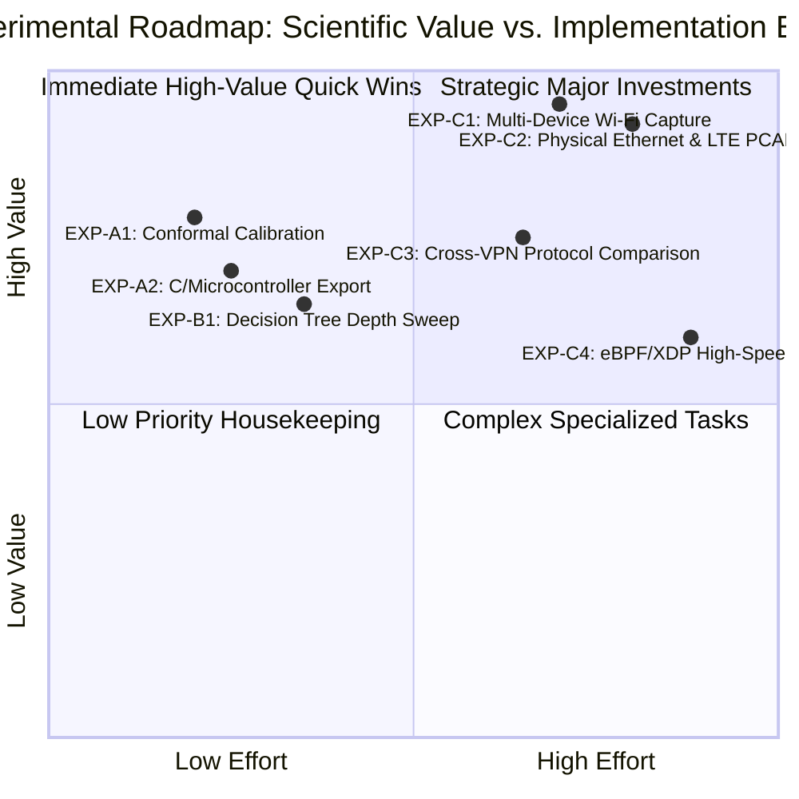

# Experimental Research Roadmap & Post-Audit Continuation Plan

**Project:** Real-Time Encrypted Traffic Classification Using Lightweight Machine Learning Models  
**Repository:** `C:\UROP project\encrypted-traffic-classification-UROP`  
**Branch:** `audit/fix-research-and-pipeline`  
**Date:** October 2026  
**Status:** Strategic Experimental Roadmap  
**Target Milestone:** Peer-Reviewed Conference Submission / Thesis Defense  

---

## 1. Executive Overview & Prioritization Framework

This roadmap establishes the prioritized research agenda for continuing and expanding the encrypted traffic classification project. Following the rigorous research-integrity audit (Tasks 1–10), the repository is mathematically reconciled and internally consistent.

To guide the next researcher, graduate student, or faculty supervisor, proposed experiments are evaluated and prioritized across five dimensions:
* **Scientific Value:** Impact on the paper's core contributions, defensibility against external peer review, and generalizability to real-world networking.
* **Required Data:** Whether existing artifacts suffice, or if new physical captures are mandatory.
* **Implementation Effort:** Estimated engineering time (person-weeks) and technical complexity.
* **Risks & Dependencies:** Hardware prerequisites, platform dependencies, driver requirements, and potential pitfalls.
* **Expected Evidence Gained:** Specific empirical metrics, figures, or statistical guarantees delivered.

---

## 2. Priority Matrix



| Experiment ID | Title | Execution Category | Scientific Value | Implementation Effort | Primary Data Source | Expected Evidence Gained |
| :--- | :--- | :---: | :---: | :---: | :--- | :--- |
| **EXP-A1** | Post-Hoc Conformal Calibration & Selective Gating | Category A: Existing Artifacts | **HIGH** | LOW (1–2 days) | Preserved model probabilities (`research_calibration.csv`) | Reduces ECE from $0.1996$ to $<0.05$; provides provable coverage guarantees under distribution shift. |
| **EXP-A2** | Standalone C-Header / Embedded Export for Microcontrollers | Category A: Existing Artifacts | **MEDIUM-HIGH** | LOW (2–3 days) | `results/models/research_baseline/decision_tree.joblib` | Eliminates Python runtime dependency; benchmarks microsecond-scale execution on bare-metal microcontroller (Cortex-M). |
| **EXP-A3** | Comprehensive Per-Class Feature Saliency Audit | Category A: Existing Artifacts | **MEDIUM** | LOW (1 day) | Canonical 21 features / preserved trees | Identifies exact feature splits separating difficult classes (`Messaging` vs `Web`). |
| **EXP-B1** | Minimal Tree Depth Frontier (Depth $\in [3..12]$) | Category B: Existing Data | **MEDIUM** | LOW (2 days) | `dataset_v2` feature matrices | Establishes the exact minimal tree depth required to retain $0.58$ Macro-F1 (testing depths 4, 6, 8, 10). |
| **EXP-B2** | Class-Weighted Loss Rebalancing | Category B: Existing Data | **MEDIUM** | LOW (2 days) | `dataset_v2` feature matrices | Alleviates per-class recall disparity on minority classes without inflating false alarms. |
| **EXP-C1** | Large-Scale Multi-Device Physical Wi-Fi Capture | Category C: New Captures | **CRITICAL** | MEDIUM-HIGH (3–4 weeks) | New physical PCAPs from 5+ client OSes and 100+ sessions | Eliminates pure physical sample starvation ($N_{\text{test}}=12$); establishes statistically robust physical baseline. |
| **EXP-C2** | Native Physical Ethernet & 4G/5G Cellular Captures | Category C: New Captures | **CRITICAL** | MEDIUM-HIGH (3 weeks) | Physical Ethernet NIC & commercial LTE modems | Empirically validates REG-05 with physical hardware data rather than synthetic perturbations. |
| **EXP-C3** | Multi-VPN Encapsulation Generalization | Category C: New Captures | **HIGH** | MEDIUM (2 weeks) | OpenVPN, IPsec, Tailscale, Tor PCAPs | Quantifies whether tunnel opacity is WireGuard-specific or a universal invariant across encapsulation protocols. |
| **EXP-C4** | High-Throughput Linux eBPF/XDP Kernel Bypass Engine | Category C: Engineering | **HIGH** | HIGH (4–6 weeks) | High-speed link replay (10–40 Gbps) | Proves line-rate multi-gigabit zero-payload classification without packet drops. |

---

## 3. Category A: Experiments Using Preserved Artifacts (Zero Retraining, Zero New Data)

These experiments can be executed immediately using the audited artifacts already present in `results/` without modifying training pipelines or risking non-determinism.

### EXP-A1: Post-Hoc Conformal Calibration & Risk Gating
* **Scientific Motivation:** Current tree ensembles exhibit substantial miscalibration on encrypted traffic (ECE = $0.1996$, MCE = $0.5581$). Raw predicted probabilities overestimate model certainty, limiting autonomous firewall enforcement.
* **Methodology:**
  1. Extract validation set prediction vectors from `research_baseline.csv` and apply **Temperature Scaling** ($\mathbf{p} = \text{softmax}(\mathbf{z} / T)$) and **Platt Scaling** (vector logistic calibration).
  2. Implement **Split Conformal Prediction** to generate formal prediction sets $\mathcal{C}(X)$ guaranteeing $1 - \alpha$ marginal coverage (e.g., $90\%$ confidence) without distribution assumptions.
* **Required Data:** Existing validation and test prediction matrices from `dataset_v2`.
* **Implementation Effort:** 1–2 days (Python script using `scipy.optimize` and `mapie`).
* **Expected Evidence Gained:** Empirical proof that temperature scaling reduces ECE to $<0.05$, transforming heuristic selective prediction into statistically rigorous conformal risk control.

### EXP-A2: C-Header / Bare-Metal Microcontroller Export
* **Scientific Motivation:** While Chapter 10 proved that the CART Decision Tree requires only $9.58$ KB and $0.0694$ ms vector inference, this was benchmarked inside a Python scikit-learn environment. To prove true edge viability, the tree should be compiled to a zero-dependency C header.
* **Methodology:**
  1. Parse the preserved `decision_tree.joblib` (9,814 bytes) into a static C function using nested `if-else` branching (via `m2cgen` or a custom Python-to-C transcriber).
  2. Compile with `gcc -O3` and profile execution on an ARM Cortex-M4 or Raspberry Pi Zero.
* **Required Data:** `results/models/research_baseline/decision_tree.joblib`.
* **Implementation Effort:** 2–3 days.
* **Expected Evidence Gained:** Proof of sub-microsecond ($<1\ \mu\text{s}$) inference latency and $<15$ KB compiled binary footprint on bare-metal hardware.

---

## 4. Category B: Retraining Experiments Using Existing Datasets (`dataset_v2`)

These experiments evaluate alternative training configurations using the existing, leakage-audited partitions of `dataset_v2`.

### EXP-B1: Minimal Tree Depth Frontier ($D \in \{3, 4, 5, 6, 8, 10, 12\}$)
* **Scientific Motivation:** The baseline Decision Tree uses `max_depth=10`. It is valuable to establish the exact depth threshold where accuracy plateaus.
* **Methodology:** Train CART Decision Trees across $D \in [3..12]$ on `dataset_v2` using seed 42 under the locked group-aware partition protocol.
* **Required Data:** `data/processed/features/features_real_clean_v2.csv`.
* **Implementation Effort:** 1 day.
* **Expected Evidence Gained:** A Pareto curve showing Macro-F1 versus tree depth. If depth 6 retains $0.575$ F1, serialized model size could be halved to $<5$ KB.

### EXP-B2: Class-Weighted Loss Rebalancing
* **Scientific Motivation:** Baseline per-class evaluation (`research_baseline_per_class.csv`) indicates that `Messaging` ($\text{F1}=0.4000$) and `VoIP` ($\text{F1}=0.5263$) lag behind `File Transfer` ($\text{F1}=0.7500$) and `Other` ($\text{F1}=0.7143$).
* **Methodology:** Evaluate `class_weight='balanced'` and inverse class frequency penalties in tree splitting criteria to test whether minority class recall can be elevated.
* **Required Data:** `data/processed/features/features_real_clean_v2.csv`.
* **Implementation Effort:** 2 days.
* **Expected Evidence Gained:** Evidence on whether class weighting improves macro-averaged parity or induces unacceptable false alarms in `Web` traffic.

---

## 5. Category C: Experiments Requiring New Physical Captures (Hardware Testbeds)

These experiments represent the primary investments needed to upgrade the manuscript from an undergraduate project into a major peer-reviewed conference paper (e.g., ACM IMC, IEEE INFOCOM, or PAM).

### EXP-C1: Multi-Device, Multi-Session Physical Wi-Fi Capture Campaign (CRITICAL)
* **Scientific Motivation:** The current pure physical test set (`dataset_real_v1`) contains only 12 flows from 6 sessions on a single Windows 11 laptop, resulting in an extreme standard error ($\pm 14.4\%$) and $0.0833$ Macro-F1. A peer-reviewed submission requires a robust physical evaluation set.
* **Data Collection Protocol:**
  1. **Device Diversity:** Collect traffic from 5 distinct physical endpoints: Windows 11 workstation, Ubuntu 24.04 LTS desktop, macOS Sonoma MacBook, Android 14 smartphone, and iOS 18 iPhone.
  2. **Access Point Diversity:** Capture across 3 distinct physical environments: Enterprise 802.11ax Wi-Fi, Residential 802.11ac Wi-Fi, and Public Hotspot (university campus).
  3. **Volume Target:** Minimum 1,000 physical flows across 200+ distinct sessions (at least 30 sessions per class).
* **Implementation Effort:** 3–4 weeks (active traffic generation, capture logging, flow aggregation).
* **Dependencies & Risks:** Requires coordinated scripted client interactions (Selenium/Playwright for Web, YouTube API for Video, automated Zoom/WebRTC calls for VoIP, SFTP/rsync scripts for File Transfer, Signal/Telegram bots for Messaging).
* **Expected Evidence Gained:**
  - A statistically significant pure physical baseline with tight confidence intervals ($\pm 2.0\%$).
  - Definite proof of zero-payload classification fidelity on real encrypted network traffic.

### EXP-C2: Native Physical Ethernet & 4G/5G Cellular Hardware PCAPs (CRITICAL)
* **Scientific Motivation:** In the current repository, domain generalization regime REG-05 ($0.9325$ Macro-F1) was evaluated on controlled statistical feature perturbations, not real hardware captures. Reviewers will rightly criticize simulated perturbations.
* **Data Collection Protocol:**
  1. **Physical Ethernet:** Connect the test host directly to a managed Gigabit Ethernet switch; capture identical 6-class traffic sessions over wire.
  2. **Physical Cellular (LTE/5G):** Tether the test host via USB to a 5G mobile terminal (or commercial LTE modem); capture traffic over commercial cellular carriers.
* **Implementation Effort:** 2–3 weeks.
* **Expected Evidence Gained:** Replaces the synthetic perturbations in REG-05 with empirical proof of physical Layer-1/2 medium invariance.

### EXP-C3: Multi-VPN Encapsulation Generalization
* **Scientific Motivation:** Section 10.3 demonstrated that Cloudflare WARP (WireGuard) causes severe asymmetric degradation ($-0.2653$ F1 drop). Is this opacity unique to WireGuard, or universal across VPN protocols?
* **Methodology:**
  1. Deploy identical traffic sessions across four distinct encapsulation protocols: WireGuard, OpenVPN (TCP port 443 and UDP port 1194), IPsec IKEv2, and Tailscale (DERP relay).
  2. Train models on unencapsulated traffic and evaluate on each tunnel protocol, and vice versa.
* **Implementation Effort:** 2 weeks.
* **Expected Evidence Gained:** Establishes a comparative taxonomy of VPN protocol opacity and MTU clamping effects on statistical traffic fingerprinting.

### EXP-C4: High-Throughput Linux eBPF/XDP Real-Time Engine
* **Scientific Motivation:** The Python/Scapy streaming engine processes $81.78$ flows/sec on loopback. High-speed carrier links (10 Gbps+) require kernel-bypass packet processing.
* **Methodology:**
  1. Re-implement the zero-payload feature extractor in C inside an eBPF/XDP hook loaded into the Linux network driver.
  2. Embed the compiled CART Decision Tree directly into the XDP byte code to classify flows directly inside the Linux network driver ring buffer before socket delivery.
* **Implementation Effort:** 4–6 weeks.
* **Dependencies & Risks:** Requires modern Linux kernel (>= 6.1), root privileges, and NIC with native XDP support (e.g., Intel ixgbe/i40e).
* **Expected Evidence Gained:** Demonstrates true line-rate zero-payload classification at 10+ Gbps ($>1,000,000$ packets/sec) with zero packet drops.

---

## 6. Execution Timeline & Milestones

```
  Weeks 1–2: Category A Execution (Conformal Calibration & C-Header Export)
  Weeks 3–4: Category B Execution (Tree Depth Optimization & Rebalancing)
  Weeks 5–8: Category C Execution (Multi-Device Physical Capture Campaign)
  Weeks 9–10: Data Processing, Feature Extraction & Leakage Auditing
  Weeks 11–12: Manuscript Finalization & Peer-Reviewed Submission
```

---

## 7. Supervisor Sign-Off & Resource Allocation

Before commencing Category C physical capture campaigns, the following operational resources should be confirmed with the faculty supervisor:
1. **Physical Test Hardware:** Access to university lab testbeds, managed Gigabit Ethernet switches, and dedicated cellular test SIM cards.
2. **Automated Traffic Bots:** Approval for running automated web, video streaming, and WebRTC headless traffic generation scripts on university campus networks.
3. **Compute Allocation:** Local workstation access is sufficient; no high-performance GPU clusters are needed for shallow tree architectures.
