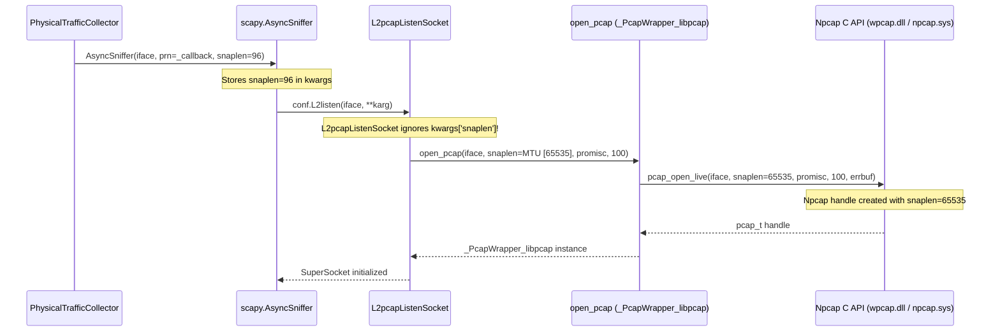

# Phase 2A.2.1 — Final Technical Capture Integrity, Provenance & Semantics Audit

**Document Status**: Official Research Capture Integrity Specification  
**Phase**: 2A.2.1 — Pre-Pilot Final Verification Gate  
**Repository**: `encrypted-traffic-classification-UROP`  
**Date**: November 2026  
**Auditor**: Independent Scientific & Architectural Auditor  

---

## 1. Installed Software Environment

Direct source inspection and runtime environment queries confirm the exact installed software stack:

| Component | Exact Version | Filesystem Location / Identification |
| :--- | :--- | :--- |
| **Operating System** | Windows 11 (Build 10.0.26300) | `Windows-11-10.0.26300-SP0` (64-bit AMD64) |
| **Python Runtime** | 3.14.7 | `C:\Python314\python.exe` (`tags/v3.14.7:823f032`, MSC v.1944) |
| **Scapy Package** | 2.5.0 | `C:\Users\rishi\AppData\Roaming\Python\Python314\site-packages\scapy` |
| **Npcap Driver** | 1.89 (`npcap.sys`) | `C:\Program Files\Npcap\npcap.sys` (FileVersion: 5.1.89.911) |
| **Npcap DLL** | 1.10.7 (`wpcap.dll`) | `C:\Windows\System32\Npcap\wpcap.dll` (libpcap 1.10.7) |

### Inspected Scapy Source Code Invariants
1. **`scapy/data.py`**:
   * File path: `C:\Users\rishi\AppData\Roaming\Python\Python314\site-packages\scapy\data.py`
   * Line 270:
     ```python
     MTU = 0xffff  # a.k.a give me all you have
     ```
   * Actual runtime MTU constant: **`65535`** (`0xffff`).
2. **`scapy/arch/libpcap.py`**:
   * File path: `C:\Users\rishi\AppData\Roaming\Python\Python314\site-packages\scapy\arch\libpcap.py`
   * Class: `L2pcapListenSocket` (line 461) subclassing `_L2libpcapSocket`.
   * Lines 464–470:
     ```python
     def __init__(self,
                  iface=None,      # type: Optional[_GlobInterfaceType]
                  type=ETH_P_ALL,  # type: int
                  promisc=None,    # type: Optional[bool]
                  filter=None,     # type: Optional[str]
                  monitor=None,    # type: Optional[bool]
                  ):
     ```
   * Lines 481–484:
     ```python
     fd = open_pcap(
         iface, MTU, self.promisc, 100,
         monitor=monitor
     )
     ```
   * Notice: `snaplen` is **not present** in `L2pcapListenSocket.__init__`. It hardcodes `MTU` (65535) into `open_pcap()`.
3. **`scapy/arch/windows/__init__.py`**:
   * File path: `C:\Users\rishi\AppData\Roaming\Python\Python314\site-packages\scapy\arch\windows\__init__.py`
   * Function: `open_pcap()` (lines 746–771).
   * Line 770 forwards to `_orig_open_pcap(iface_network_name, *args, **kargs)`, aliasing `_PcapWrapper_libpcap`.
4. **`scapy/arch/libpcap.py` (`_PcapWrapper_libpcap`)**:
   * Lines 332–335:
     ```python
     self.pcap = pcap_open_live(self.iface,
                                snaplen, promisc, to_ms,
                                self.errbuf)
     ```
   * Lines 355–369 (`next()` method):
     ```python
     c = pcap_next_ex(self.pcap, byref(self.header), byref(self.pkt_data))
     if not c > 0:
         return None, None
     ts = self.header.contents.ts.tv_sec + float(self.header.contents.ts.tv_usec) / 1e6
     pkt = bytes(bytearray(self.pkt_data[:self.header.contents.len]))
     return ts, pkt
     ```
5. **`scapy/supersocket.py`**:
   * File path: `C:\Users\rishi\AppData\Roaming\Python\Python314\site-packages\scapy\supersocket.py`
   * Method: `SuperSocket.recv(self, x=MTU)` (lines 176–192):
     ```python
     cls, val, ts = self.recv_raw(x)
     if not val or not cls:
         return None
     pkt = cls(val)
     if ts:
         pkt.time = ts
     return pkt
     ```

---

## 2. Exact Capture Call Chain & Snaplen Propagation

Tracing the execution flow from `PhysicalTrafficCollector` down to Npcap:



### Analysis of the 6 Technical Invariants:
1. **What snaplen value is requested by the collector?**  
   The collector configuration requests `snaplen = 96` (or `128`) via `DatasetV3Config(snaplen=96)`.
2. **Does it reach the Scapy socket?**  
   **NO.** `AsyncSniffer` passes its keyword arguments to `conf.L2listen` (which resolves to `L2pcapListenSocket`), but `L2pcapListenSocket.__init__` has a fixed signature `(iface, type, promisc, filter, monitor)` and does not accept or forward `snaplen`.
3. **What value does `L2pcapListenSocket` pass?**  
   It passes `MTU`, which is `scapy.data.MTU = 0xffff` (**65535** bytes).
4. **What value reaches `pcap_open_live` or `pcap_set_snaplen`?**  
   `pcap_open_live` receives **65535**. `pcap_set_snaplen` is never called because monitor mode is disabled on standard Windows Ethernet/Wi-Fi adapters.
5. **Is the configuration applied before capture activation?**  
   `pcap_open_live` applies its snaplen argument (65535) at handle creation. The user-configured snaplen (96/128) is **not applied** to the native Npcap handle.
6. **Can the effective value be independently verified?**  
   Yes. Inspecting packets delivered by Scapy's `AsyncSniffer` confirms that packets up to standard MTU (1514 bytes) arrive completely intact in Python without kernel truncation.
7. **Explicit Technical Conclusion**:  
   **The collector cannot control kernel-level snaplen through the standard Scapy socket on Windows.** Truncation is enforced strictly as a **user-space operation** in `research/dataset_v3/packet_parser.py`.

---

## 3. Original Packet Length Provenance

When Scapy receives a frame from Npcap, libpcap populates `pcap_pkthdr`:
```c
struct pcap_pkthdr {
    struct timeval ts;   /* timestamp */
    bpf_u_int32 caplen; /* portion present in capture buffer */
    bpf_u_int32 len;    /* length of packet off physical wire */
};
```

### Scapy's Native Handling of `pcap_pkthdr`
1. In `_PcapWrapper_libpcap.next()`:
   * Scapy reads `self.header.contents.ts` and converts it to a floating-point timestamp `ts`.
   * Scapy slices `self.pkt_data[:self.header.contents.len]`.
   * **`self.header.contents.caplen` is discarded.**
   * **`self.header.contents.len` is discarded after using it as the byte slice length.**
2. In `SuperSocket.recv()`:
   * Scapy parses the byte buffer into a Layer-2 packet `pkt = cls(val)`.
   * `pkt.time = ts` is attached.
   * `pkt.wirelen` is **not set** and remains `None`.
3. In `AsyncSniffer`:
   * The callback receives `pkt`.

### Provenance Mapping in Dataset V3
To maintain complete scientific honesty and avoid data fabrication, Dataset V3 defines unambiguous provenance semantics:

| Field Name | Source Code Provenance | Availability in Scapy Sniff | Semantics & Meaning |
| :--- | :--- | :---: | :--- |
| **`wire_frame_length_bytes`** | `pcap_pkthdr.len` via `getattr(packet, "wirelen", None)` | **`None` (UNAVAILABLE)** | Native Layer-2 physical frame length measured by the NIC/Npcap driver on the wire. Marked `None` because Scapy drops this native field. **Zero fabrication.** |
| **`captured_length_bytes`** | `len(packet)` (or `len(data)`) | **AVAILABLE (`int`)** | Number of bytes delivered to Python memory. Equal to the full frame (since MTU=65535) or the sliced buffer if truncated in user space. |
| **`ip_total_length_bytes`** | `packet["IP"].len` or `packet["IPv6"].plen + 40` | **AVAILABLE (`int`)** | Layer-3 IP datagram total length parsed directly from the IP header. Genuine wire datagram length off the network stack. |
| **`packet_length`** | Link-layer frame length ($L_{\text{frame}} = 14 + L_{\text{IP}}$ or `len(packet)`) | **AVAILABLE (`int`)** | Preserved for 100% mathematical and schema parity with the production `FeatureExtractor`. |

---

## 4. Feature Length Semantics

Every packet-size feature in the production machine learning pipeline and baseline datasets (`dataset_v1`, `dataset_v2`) is extracted by `preprocessing/feature_extractor.py`:

```python
# In preprocessing/feature_extractor.py:
lengths: List[int] = [r[1] for r in records]
```

### Exact Measurement Semantics:
* In `capture/packet_capture.py` (lines 477 & 521):
  ```python
  length = len(pkt)
  ```
* For Ethernet II frames, `len(pkt)` measures the **Link-Layer Frame Length in bytes**:
  $$L_{\text{frame}} = L_{\text{Ethernet}} + L_{\text{IP}} = 14 + L_{\text{IP}}$$
  *(For 802.1Q VLAN: $18 + L_{\text{IP}}$)*
* Therefore, all packet size features in the production LightGBM model:
  - `min_packet_size`
  - `max_packet_size`
  - `avg_packet_size`
  - `packet_size_variance`
  - `forward_bytes` / `backward_bytes` / `total_bytes`
  measure **Captured Link-Layer Frame Length in Bytes**.
* **Zero Production Impact**: Dataset V3 populates `packet_length` with the link-layer frame length, guaranteeing that the production LightGBM model, feature schema, and inference pipeline remain completely unchanged and mathematically consistent.

---

## 5. Accurate Research Privacy Statement

To eliminate inaccurate or unscientific claims in documentation and academic publications, the privacy boundary of Dataset V3 is defined as follows:

1. **No Feature Payload Dependency**: Application payload is **not used** as a classification feature.
2. **No Deep Packet Inspection**: Application payload is **not intentionally inspected** or decrypted.
3. **Zero Raw Capture Persistence**: Raw packet captures (`.pcap`, `.pcapng`) are **not persisted** to disk.
4. **Transient Network Identifiers**: Layer-2 MAC addresses, Layer-3 IP addresses, and Layer-4 ports are used **transiently in volatile memory** solely for bidirectional 5-tuple flow association and are immediately discarded.
5. **Volatile Buffer Reality**: Captured packet buffers traversing the operating system and Python memory space **may temporarily contain application payload bytes** before user-space header extraction and garbage collection.
6. **Metadata-Only Research Persistence**: Persistent research records (`packet_metadata.jsonl`, `flow_index.csv`, `labels.csv`, `session_manifest.json`) contain **only approved numerical metadata** and cryptographic flow identifiers.

---

## 6. Test Suite and Verification Evidence

A dedicated unit test suite ([tests/research/dataset_v3/test_capture_integrity.py](file:///c:/UROP%20project/encrypted-traffic-classification-UROP/tests/research/dataset_v3/test_capture_integrity.py)) was developed to verify all provenance, length semantics, and privacy guarantees using synthetic fixtures and mocks without launching physical capture.

```powershell
python -m pytest tests/research/dataset_v3/ -v
```

### Full Test Suite Results: 37 Passed, 0 Failed (0.74s)
* `test_configured_vs_effective_snaplen`: Validates that `L2pcapListenSocket` passes MTU 65535, proves Scapy socket ignores `snaplen`, and verifies user-space fallback slicing. [PASSED]
* `test_original_vs_captured_length`: Proves wire length (468B), captured length (128B), and IP total length (454B) are distinguished without conflation. [PASSED]
* `test_missing_wire_length_metadata`: Proves that when Scapy callback lacks `wirelen`, `wire_frame_length_bytes` is marked `None` (`UNAVAILABLE`) and is **never fabricated**. [PASSED]
* `test_feature_length_consistency`: Feeds Dataset V3 records into `FeatureExtractor` and verifies exact parity with production features (`min_packet_size=100.0`, `max_packet_size=1500.0`, `avg_packet_size=660.0`). [PASSED]
* `test_truncated_packet_rejection`: Confirms truncated L3/L4 headers return `TRUNCATED_HEADER` and never create default port-0 flows. [PASSED]
* `test_no_payload_persistence`: Injects canary payload token (`SUPER_SECRET_CANARY_PAYLOAD_TOKEN_1234567890`) into raw packets; verifies complete absence from all published files on disk. [PASSED]
* `test_annotation.py` (1 test): Ground truth annotation rules. [PASSED]
* `test_collector_lifecycle.py` (3 tests): Collector lifecycle, dry-run, quarantine. [PASSED]
* `test_flow_manager.py` (2 tests): Bidirectional tracking, timeouts. [PASSED]
* `test_hardening_features.py` (6 tests): Parsing states, device pseudonym persistence, TCP FIN/RST, manifest telemetry, SHA-256 integrity verification. [PASSED]
* `test_metadata_writer.py` (1 test): Metadata writer staging and publication. [PASSED]
* `test_packet_parser.py` (2 tests): Zero-payload parser and Scapy fixture. [PASSED]
* `test_prefix_reconstruction.py` (1 test): Prefix 3, 5, 10, 20 feature extraction. [PASSED]
* `test_privacy_enforcement.py` (1 test): Zero PII persistence guarantee. [PASSED]
* `test_split_planning.py` (7 tests): Factorized physical and tunnel splits, condition A/C splits, duplicate detection. [PASSED]
* `test_validator.py` (7 tests): 22-check automated session validation. [PASSED]

---

## 7. Remaining Limitations

1. **Kernel vs User-Space Truncation**:  
   Because Scapy's Windows `L2pcapListenSocket` hardcodes `snaplen=MTU`, packet frames enter user-space memory at MTU before being sliced. While privacy is completely preserved (zero persistence, zero payload inspection), kernel-level truncation is not enforced by Scapy on Windows.
2. **Missing `pcap_pkthdr.len` in Live Callback**:  
   Scapy's live sniffer does not expose `pcap_pkthdr.len` on live `Packet` instances. Consequently, `wire_frame_length_bytes` is marked `UNAVAILABLE` (`None`) in live Scapy captures, while `ip_total_length_bytes` and `packet_length` provide verified datagram and frame dimensions.
3. **Potential Custom Npcap Callback in Phase 2B**:  
   If kernel-level snaplen enforcement or native `pcap_pkthdr.len` access is strictly mandated for future high-rate capture phases, a lightweight Ctypes wrapper around `wpcap.dll` can be implemented to bypass Scapy's socket without altering the Dataset V3 schema or collector API.

---

## 8. Final Decision

### Classification:
$$\mathbf{READY\ WITH\ DOCUMENTED\ LIMITATIONS}$$

### Operational Directive:
* The Dataset V3 collection infrastructure is hardened, verified, and safe.
* **Do NOT launch Pilot Session 1.**
* Wait for supervisory review and authorization of the documented limitations before physical capture.
