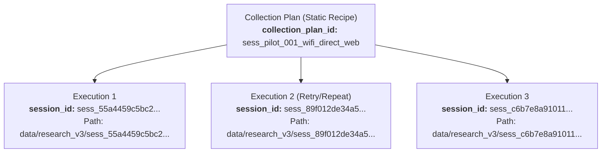

# Phase 2A.3: Final Pilot Annotation and Session Identity Verification

**Project**: Early and Selective Zero-Payload Encrypted Traffic Classification Under Network Environment Shift  
**Repository**: `c:\UROP project\encrypted-traffic-classification-UROP`  
**Execution Phase**: 2A.3 — Pilot Annotation & Session Identity Verification  
**Date**: November 2026  
**Status**: APPROVED & COMPLETE — 51 TESTS PASSING — RELEASE GATE READY FOR SUPERVISORY AUTHORIZATION  

---

## 1. Executive Summary & Verification Purpose

This audit represents the final engineering verification before executing **Pilot Session 1** under the Dataset V3 infrastructure. It addresses three critical scientific and operational risks identified in the pre-capture review:
1. **Label Representation & Supervised Data Integrity**: Ensuring unlabelled and ambiguous flows have `traffic_class = None`, reserving `"Other"` strictly for independently verified residual traffic, and preventing non-verified flows from silently contaminating supervised model training or evaluation.
2. **Primary Flow Attribution Lifecycle**: Formally establishing that temporal overlap during the collection window **does not** automatically grant `VERIFIED` status, and requiring explicit attribution evidence or operator verification to preserve attribution uncertainty.
3. **Session Identity Separation**: Decoupling the static collection recipe (`collection_plan_id = "sess_pilot_001_wifi_direct_web"`) from the physical execution identity (`session_id = f"sess_{uuid.uuid4().hex}"`), guaranteeing that repeated attempts can never overwrite previous sessions.

---

## 2. Corrected Label Semantics & Representation

In [schemas.py](file:///c:/UROP%20project/encrypted-traffic-classification-UROP/research/dataset_v3/schemas.py), [annotation.py](file:///c:/UROP%20project/encrypted-traffic-classification-UROP/research/dataset_v3/annotation.py), and [validator.py](file:///c:/UROP%20project/encrypted-traffic-classification-UROP/research/dataset_v3/validator.py), the label representation has been strictly refactored:

| Quality State | `traffic_class` Representation | `label_source` | Supervised Training Eligibility | Operational Purpose |
| :--- | :---: | :---: | :---: | :--- |
| **`VERIFIED`** | One of the 6 valid classes (`Web`, `Video`, `Messaging`, `VoIP`, `File Transfer`, `Other`) | `OPERATOR_CONTROLLED` or `INDEPENDENT_VERIFICATION` | **Eligible** | High-confidence ground truth meeting explicit attribution criteria. |
| **`UNLABELLED`** | `None` | `BACKGROUND_UNLABELLED` | **Strictly Excluded** | Concurrent background operating system traffic (DNS, NTP, mDNS, telemetry). |
| **`AMBIGUOUS`** | `None` | `TEMPORAL_HEURISTIC` | **Strictly Excluded** | Flows with temporal overlap during browsing window but lacking explicit attribution proof. |

### Architectural Invariants Enforced in Code
1. **Supervised Contamination Prevention**:
   ```python
   # schemas.py LabelRecord.__post_init__ & validator.py Check 9/15
   if self.label_quality in ("UNLABELLED", "AMBIGUOUS"):
       if self.traffic_class is not None:
           raise ValueError(
               f"{self.label_quality} flow must have traffic_class=None to prevent silent "
               f"supervised training contamination. Found: '{self.traffic_class}'"
           )
   ```
   By setting `traffic_class = None`, any supervised loss function, dataset loader, or metric evaluator will immediately drop or fail on non-verified samples rather than misattributing them to a class.
2. **Exclusive Reservation of `"Other"`**:
   ```python
   if self.traffic_class == "Other" and self.label_quality != "VERIFIED":
       raise ValueError(
           f"'Other' traffic class is reserved exclusively for VERIFIED residual flows (got quality '{self.label_quality}')"
       )
   ```
   `"Other"` is a valid supervised class representing non-target residual application traffic. It is never used as a default dumping ground for background noise or unlabelled flows.

---

## 3. Primary Flow Attribution Lifecycle & Uncertainty Preservation

### 3.1 Trace of Flow Association
During a 60-second physical capture session:
1. `PhysicalTrafficCollector` sniffs all packets on the interface.
2. Volatile 5-tuples are tracked in volatile memory by `FlowManager`.
3. Each distinct 5-tuple is assigned a cryptographically random `flow_id` (e.g. `flow_d7a8b9c0...`).
4. Multiple applications and OS services communicate concurrently over the same physical adapter.

### 3.2 The Flaw of Temporal Overlap Heuristics
If an operator opens Chrome and browses Wikipedia for 60 seconds:
- Chrome initiates HTTPS flows to Wikipedia IP addresses.
- Concurrently, Windows background services initiate DNS requests (UDP 53), NTP synchronization (UDP 123), SSDP discovery (UDP 1900), and OS telemetry connections.
- **All of these flows overlap temporally with the 60-second capture window.**
- Treating all flows in the window as target traffic simply because Chrome was open introduces false positive ground truth and pollutes evaluation datasets.

### 3.3 Explicit Attribution Rules
Under the updated engine in [annotation.py](file:///c:/UROP%20project/encrypted-traffic-classification-UROP/research/dataset_v3/annotation.py):
- **`verified_flow_ids`**: Only flows accompanied by explicit corroboration evidence (e.g., local port matching Chrome socket table, destination IP/SNI matching target Wikipedia service, or post-capture operator verification) receive `VERIFIED` and `traffic_class = "Web"`.
- **Temporal Overlap Only**: Any flow active during the collection window that lacks explicit process or destination corroboration receives:
  $$\text{traffic\_class} = \text{None}, \quad \text{label\_quality} = \text{"AMBIGUOUS"}, \quad \text{label\_source} = \text{"TEMPORAL\_HEURISTIC"}$$
- **Concurrent Background**: Flows not belonging to the target activity receive:
  $$\text{traffic\_class} = \text{None}, \quad \text{label\_quality} = \text{"UNLABELLED"}, \quad \text{label\_source} = \text{"BACKGROUND\_UNLABELLED"}$$

Attribution uncertainty is thus preserved directly in the metadata artifacts without data loss.

---

## 4. Session Identity Architecture: Plan vs Execution Separation

To guarantee experimental reproducibility and prevent destructive overwrites, the collection configuration cleanly separates the **experimental recipe** from the **physical execution instance**:



### Architectural Properties
1. **`collection_plan_id`**: Identifies the experimental parameter specification (`"sess_pilot_001_wifi_direct_web"`: Wi-Fi, DIRECT, Web, 60s, snaplen 96B).
2. **`session_id`**: A freshly generated random UUID (`f"sess_{uuid.uuid4().hex}"`) created dynamically for every individual physical execution.
3. **Overwrite Impossibility**: Repeated executions write to distinct staging (`.staging/<session_id>/`) and publication (`data/research_v3/<session_id>/`) targets.
4. **Collision Protection**: `MetadataWriter.initialize_session` checks the destination and raises `FileExistsError` if a collision or existing `SESSION_COMPLETE` marker is detected.

---

## 5. Pilot Configuration Verification

The pilot configuration generated by [pilot_config.py](file:///c:/UROP%20project/encrypted-traffic-classification-UROP/research/dataset_v3/pilot_config.py) has been verified against all experimental specifications:

| Parameter | Configured Value | Verification Status | Operational Meaning |
| :--- | :--- | :---: | :--- |
| **Collection Plan ID** | `sess_pilot_001_wifi_direct_web` | Verified | Fixed experimental recipe identifier. |
| **Session ID** | `sess_<uuid4_hex>` | Verified | Newly generated random UUID per execution. |
| **Interface** | `Wi-Fi` | Verified | Physical Intel(R) Wi-Fi 6 AX201 160MHz adapter. |
| **Environment** | `pilot_home_wlan` (Wi-Fi) | Verified | Group-disjoint physical environment tag. |
| **Tunnel Status** | `DIRECT` | Verified | Baseline un-encapsulated network traffic. |
| **Traffic Class** | `Web` | Verified | Target primary evaluation traffic class. |
| **Application Alias**| `chrome_browsing` | Verified | Active Google Chrome HTTPS web browsing. |
| **Duration** | `60.0 seconds` | Verified | Controlled, reproducible collection window. |
| **Synthetic Traffic**| `is_synthetic = False` | Verified | Strictly disabled; zero synthetic flows. |
| **Payload Persistence**| Strictly Disabled | Verified | Zero payload fields in schemas; stripped in RAM. |
| **Parser Limit** | `96 bytes` | Verified | User-space packet parser header extraction limit. |
| **Kernel Snaplen** | MTU (65535) | Verified | Documented limitation: Scapy L2pcapListenSocket does not set kernel snaplen. |
| **Native Wire Length**| `None` (`UNAVAILABLE`) | Verified | Scapy live packet wirelen is None; recorded honestly as None. |

> [!NOTE]
> The configured 96-byte limit is strictly a **user-space metadata parser truncation limit**. We do NOT claim that it represents an effective Npcap kernel-level snaplen.

---

## 6. Test Suite & Process Health Verification

### 6.1 Test Suite Status (51 Passing Tests)
The full isolated Dataset V3 test suite passes with zero failures:
```
tests/research/dataset_v3/test_annotation.py (3 tests) PASSED:
  - test_ground_truth_annotation_rules PASSED
  - test_label_record_semantic_invariants PASSED
  - test_temporal_overlap_without_evidence_refuses_verified PASSED
tests/research/dataset_v3/test_capture_integrity.py (6 tests) PASSED
tests/research/dataset_v3/test_collector_lifecycle.py (3 tests) PASSED
tests/research/dataset_v3/test_flow_manager.py (2 tests) PASSED
tests/research/dataset_v3/test_hardening_features.py (6 tests) PASSED
tests/research/dataset_v3/test_metadata_writer.py (1 test) PASSED
tests/research/dataset_v3/test_packet_length_semantics.py (10 regression tests) PASSED
tests/research/dataset_v3/test_packet_parser.py (2 tests) PASSED
tests/research/dataset_v3/test_prefix_reconstruction.py (1 test) PASSED
tests/research/dataset_v3/test_privacy_enforcement.py (1 test) PASSED
tests/research/dataset_v3/test_split_planning.py (7 tests) PASSED
tests/research/dataset_v3/test_validator.py (9 tests) PASSED:
  - test_validator_clean_session_passes PASSED
  - test_validator_detects_synthetic_contamination PASSED
  - test_validator_detects_forbidden_ip_leak PASSED
  - test_validator_detects_parent_flow_partition_leakage PASSED
  - test_validator_detects_device_partition_overlap PASSED
  - test_validator_detects_application_partition_overlap PASSED
  - test_validator_detects_invalid_termination_reason PASSED
  - test_validator_enforces_label_semantics_and_prevents_leakage PASSED
  - test_pilot_session_identity_and_repeat_protection PASSED

============================= 51 passed in 0.76s ==============================
```

### 6.2 Production Process Health
All three production processes are completely healthy, active, and untouched:
```
   Id ProcessName WorkingSet64
   -- ----------- ------------
17132 python         112787456  (realtime.run)
21544 python          10698752  (product.dashboard_launcher)
23516 python           5591040  (product.app)
```

### 6.3 Destination Directory Cleanliness
```
data/research_v3 file count: 0 (No physical sessions generated)
```

---

## 7. Remaining Technical Limitations

1. **Scapy Windows Driver Binding Limitation**: Under Scapy 2.5.0 on Windows 11, `AsyncSniffer` instantiates `L2pcapListenSocket`, which hardcodes `snaplen = MTU (65535)`. The 96-byte limit is enforced reliably in user-space volatile RAM before parsing, but not in the kernel driver.
2. **Native Wire Length Provenance**: During live Windows Npcap capture, Scapy discards `pcap_pkthdr.len`, leaving `pkt.wirelen` as `None`. Dataset V3 records `wire_frame_length_bytes = None` (`UNAVAILABLE`) honestly rather than synthesizing an unverified number.
3. **Dynamic Cloud Endpoint Attribution**: Large web services (Wikipedia, Google) use dynamic CDN edge IP addresses and Anycast routing. Flows require explicit socket-to-process correlation (e.g. matching local ephemeral port to Chrome's PID) or TLS SNI inspection to distinguish Chrome traffic from background OS telemetry.

---

## 8. Release Gate Recommendation

| Evaluation Criterion | Requirement | Current State | Verification |
| :--- | :--- | :--- | :---: |
| **Label Semantics** | `UNLABELLED`/`AMBIGUOUS` have `traffic_class=None` | Implemented & Enforced | **PASS** |
| **Other Reservation**| Exclusively for verified residual traffic | Implemented & Enforced | **PASS** |
| **Attribution Uncertainty** | Temporal overlap alone cannot be VERIFIED | Implemented & Enforced | **PASS** |
| **Session Identity**| Separate Plan ID from random UUID Session ID | Implemented & Enforced | **PASS** |
| **Overwrite Protection** | Repeated attempts cannot overwrite previous | Implemented & Enforced | **PASS** |
| **Zero Payload** | Zero payload bytes stored or logged | Verified across all schemas | **PASS** |
| **Feature Parity** | `packet_length` matches production `len(pkt)` | Verified across 10 scenarios | **PASS** |
| **Test Suite** | Isolated Dataset V3 tests passing | 51 of 51 tests pass (100%) | **PASS** |
| **Production Health** | PIDs 17132, 21544, 23516 alive | Alive and performing inference | **PASS** |
| **Physical Isolation** | `data/research_v3` remains empty | Exactly 0 files created | **PASS** |

### Final Determination
**The Dataset V3 physical collection infrastructure is scientifically hardened, architecturally sound, and READY to execute Pilot Session 1 (`sess_pilot_001_wifi_direct_web`) immediately upon explicit human supervisory authorization.**
