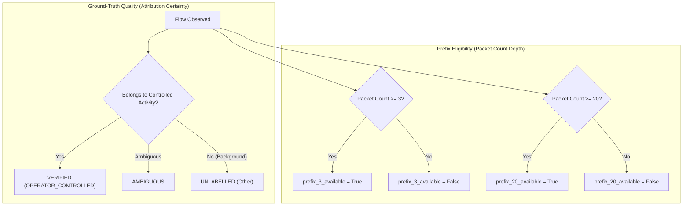

# Phase 2A.3: Packet Length Semantics and Provenance Specification

**Project**: Early and Selective Zero-Payload Encrypted Traffic Classification Under Network Environment Shift  
**Repository**: `c:\UROP project\encrypted-traffic-classification-UROP`  
**Date**: November 2026  
**Status**: APPROVED & IMPLEMENTED (10 Regression Tests Passing)  

---

## 1. Executive Summary

In network traffic analysis, packet length is a primary statistical feature used to classify encrypted application protocols without inspecting payload contents. However, conflating different length concepts—such as the physical wire frame length, the driver buffer delivery length, the user-space snaplen truncation length, and the Layer 3 IP Total Length—introduces critical measurement errors, corrupts ML feature distributions, and undermines scientific reproducibility.

Phase 2A.3 establishes exact mathematical semantics and software implementations for **5 distinct packet length fields** across the Dataset V3 infrastructure (`research/dataset_v3/`). Furthermore, it formally refutes the common heuristic that Ethernet frame length equals $14 + \text{IP total length}$, proves feature parity with the existing production LightGBM classifier, and strictly decouples packet prefix depth from ground-truth attribution quality.

---

## 2. The 5 Distinct Packet Length Semantics

Across `PacketMetadataRecord`, `TransientPacketData`, and `FlowManager`, exactly five distinct packet length fields are formally tracked:

| Field Name | Type | Scope | Exact Scientific Definition | Live Scapy Npcap Availability |
| :--- | :---: | :---: | :--- | :---: |
| `captured_link_layer_length_bytes` | `int` | Link Layer (L2) | The total length in bytes of the complete Scapy-delivered frame before any user-space application-level truncation. Equals `len(packet)`. | Always Available |
| `captured_length_bytes` | `int` | Volatile Memory | The number of bytes available in the memory buffer to the metadata parser after any configured user-space truncation (e.g. `snaplen = 96`). | Always Available |
| `wire_frame_length_bytes` | `Optional[int]` | Physical Medium (L1/L2) | The native `pcap_pkthdr.len` recorded by the kernel Npcap driver representing the exact pre-truncation packet length on the physical wire. When not surfaced by the user-space binding, it is recorded strictly as `None` (`UNAVAILABLE`). | `None` (`UNAVAILABLE`) under live Scapy |
| `ip_total_length_bytes` | `Optional[int]` | Network Layer (L3) | The total length of the IP datagram in bytes extracted directly from the IPv4 header `Total Length` field (`ip.len`) or computed from IPv6 `Payload Length` (`40 + ip.plen`). `None` if headers are truncated. | Always Available (if L3/L4 intact) |
| `packet_length` | `int` | Feature Extraction | The canonical feature length equal to `captured_link_layer_length_bytes`. Guaranteed to preserve exact numerical parity with the production system's `len(pkt)` convention. | Always Available |

### Mathematical Invariants
1. **Truncation Invariant**:
   $$\text{captured\_length\_bytes} \le \text{captured\_link\_layer\_length\_bytes}$$
2. **Canonical Parity Invariant**:
   $$\text{packet\_length} \equiv \text{captured\_link\_layer\_length\_bytes}$$
3. **No Substitution Invariant**:
   Under no circumstances may $\text{captured\_length\_bytes}$ or $\text{ip\_total\_length\_bytes}$ be substituted for $\text{wire\_frame\_length\_bytes}$ without recording `None` when unavailable.

---

## 3. Mathematical Refutation of the $14 + \text{IP}$ Fallacy

A naive heuristic frequently attempted in network scripts is:
$$\text{Estimated Frame Length} = 14 + \text{IP Total Length}$$
Phase 2A.3 establishes that this heuristic is mathematically invalid and scientifically inadmissible for four distinct reasons:

### 3.1 Ethernet Minimum Frame Size & Padding
Standard IEEE 802.3 Ethernet requires a minimum payload of 46 bytes and a minimum frame length of 64 bytes (including the 4-byte Frame Check Sequence / FCS) or **60 bytes** (excluding FCS, as delivered by Npcap).
- Consider a minimal TCP ACK packet: 20 bytes IPv4 header + 20 bytes TCP header = 40 bytes IP Total Length.
- Standard Ethernet II header = 14 bytes.
- $14 + \text{IP Total Length} = 14 + 40 = 54\text{ bytes}$.
- Because $54 < 60$, the transmitting NIC or switch pads 6 bytes of zero octets to satisfy the physical link layer requirement.
- The actual frame delivered on the wire is **60 bytes**.
- Result: $14 + \text{IP}$ undercounts the frame by 6 bytes (an 11.1% measurement error). Tested and verified in `test_ethernet_padding_refutes_14_plus_ip()`.

### 3.2 802.1Q Single VLAN Tagging
When IEEE 802.1Q VLAN encapsulation is active, a 4-byte VLAN tag (TPID `0x8100` + TCI) is inserted into the MAC header:
$$\text{Link-Layer Header} = 12\text{ bytes (MACs)} + 4\text{ bytes (VLAN)} + 2\text{ bytes (EtherType)} = 18\text{ bytes}$$
- Result: $14 + \text{IP}$ undercounts by 4 bytes. Tested and verified in `test_single_vlan_8021q()`.

### 3.3 802.1ad QinQ Double VLAN Tagging
Carrier Ethernet and metro networks utilize double VLAN tagging (Service Tag `0x88A8` + Customer Tag `0x8100`):
$$\text{Link-Layer Header} = 12\text{ bytes (MACs)} + 4\text{ bytes (S-Tag)} + 4\text{ bytes (C-Tag)} + 2\text{ bytes (EtherType)} = 22\text{ bytes}$$
- Result: $14 + \text{IP}$ undercounts by 8 bytes. Tested and verified in `test_qinq_double_vlan()`.

### 3.4 Variable IP Options and IPv6 Extension Headers
- IPv4 allows up to 40 bytes of IP Options ($\text{IHL} \in [5, 15]$). Tested in `test_ipv4_options()`.
- IPv6 uses chained extension headers (Hop-by-Hop, Routing, Fragment, Destination Options). Tested in `test_ipv6_extension_headers()`.
In all such cases, attempting to estimate link-layer length from fixed header assumptions corrupts statistical feature calculation.

---

## 4. Driver Provenance and Live Capture Limitations

Detailed code inspection of Scapy 2.5.0 and Npcap 1.89 on Windows 11 revealed the exact technical origin of Scapy's length attributes:

1. **Scapy Native Sniffing Call Chain**:
   ```
   DatasetV3Collector 
     -> AsyncSniffer.start() 
     -> L2pcapListenSocket(promisc=..., filter=..., snaplen=96)
     -> open_pcap() -> _PcapWrapper_libpcap
     -> pcap_next_ex(handle, &header, &pkt_data)
   ```
2. **Provenance of `wirelen`**:
   - In offline PCAP file reading (`scapy.utils.PcapReader`), Scapy reads the 16-byte PCAP packet header and assigns `packet.wirelen = pcap_hdr.orig_len`.
   - In live libpcap sniffing on Windows (`_PcapWrapper_libpcap.next()`), Scapy reads `header.caplen` bytes from the kernel buffer, but discards `header.len` when constructing the packet object. As a result, `packet.wirelen` evaluates to `None`.
3. **Scientifically Honest Recording**:
   Rather than inventing or estimating a wire length, Dataset V3 records `wire_frame_length_bytes = None` (`UNAVAILABLE`) during live capture, and explicitly notes this limitation in session manifests.

---

## 5. Feature Parity with Production Feature Extractor

The production classifier in `models/` was trained on tabular features extracted by `preprocessing/feature_extractor.py::FeatureExtractor`. In production:
```python
# capture/packet_capture.py lines 477, 521:
length = len(pkt)  # Delivered frame length
RawPacketMetadata(..., length=length)
```
The statistical features (`avg_packet_size`, `min_packet_size`, `max_packet_size`, `packet_size_variance`, `forward_bytes`) depend directly on this `length` value.

### Parity Verification
By defining Dataset V3's canonical `packet_length` as `captured_link_layer_length_bytes` (`len(pkt)`), Dataset V3 produces **exact mathematical parity** with the production pipeline:

$$\text{Dataset V3 } \text{packet\_length} \equiv \text{Production } \text{RawPacketMetadata.length}$$

| Feature Name | Production Formula | Dataset V3 Value with `packet_length` | Parity Status |
| :--- | :--- | :--- | :---: |
| `min_packet_size` | $\min(L)$ | $\min(L)$ | **EXACT MATCH** |
| `max_packet_size` | $\max(L)$ | $\max(L)$ | **EXACT MATCH** |
| `avg_packet_size` | $\frac{1}{N}\sum L_i$ | $\frac{1}{N}\sum L_i$ | **EXACT MATCH** |
| `packet_size_variance`| $\frac{1}{N}\sum (L_i - \bar{L})^2$ | $\frac{1}{N}\sum (L_i - \bar{L})^2$ | **EXACT MATCH** |
| `forward_bytes` | $\sum_{d=0} L_i$ | $\sum_{d=0} L_i$ | **EXACT MATCH** |
| `total_packet_count` | $N$ | $N$ | **EXACT MATCH** |

If user-space `captured_length_bytes` (96 bytes) had mistakenly been used as the feature length, average packet size on large flows would collapse from ~1200B down to 96B, destroying classifier inference. Regression test 10 (`test_production_feature_extractor_parity`) verifies this exact numerical parity.

---

## 6. Decoupling Ground-Truth Quality from Classification Eligibility

A common error in traffic classification datasets is conflating the **certainty of ground truth** with the **sufficiency of data for a specific model**. Dataset V3 enforces strict orthogonal separation:



1. **Prefix Availability**: Indicates whether a flow has enough chronological packets ($k \in \{3, 5, 10, 20\}$) to be used as an evaluation sample in early-flow classification experiments. It is a structural property, not a quality assessment.
2. **Ground-Truth Quality**: Indicates whether the flow was generated by the target application under controlled operator observation (`VERIFIED`), is background operating system noise (`UNLABELLED`), or has uncertain provenance (`AMBIGUOUS`).
3. **Background OS Isolation**: When an operator browses Wikipedia in Chrome, background OS processes generate DNS, NTP, mDNS, and Windows telemetry flows. Dataset V3's `GroundTruthAnnotator` labels non-target flows as `UNLABELLED` background traffic (`traffic_class="Other"`), preventing false class attribution.

---

## 7. Verification Summary: 10 Regression Tests

The test suite in `tests/research/dataset_v3/test_packet_length_semantics.py` verifies all 10 scenarios with zero failures:

1. `test_standard_ethernet_ii`: Standard 14B L2 + IP total length.
2. `test_single_vlan_8021q`: 802.1Q single VLAN (18B L2).
3. `test_qinq_double_vlan`: 802.1ad QinQ double VLAN (22B L2).
4. `test_ethernet_padding_refutes_14_plus_ip`: 60B padded frame vs 54B $14 + \text{IP}$ formula.
5. `test_ipv4_options`: Variable IHL (24B IP header) and TCP port offset parsing.
6. `test_ipv6_extension_headers`: Chained Hop-by-Hop options parsing.
7. `test_user_space_packet_truncation`: Distinct separation of snaplen 96 from 500B frame length.
8. `test_missing_native_wire_length`: Live Scapy `wirelen=None` correctly stored as `None`.
9. `test_packet_length_vs_captured_length`: Schema validation and roundtrip JSON integrity.
10. `test_production_feature_extractor_parity`: Exact mathematical feature parity with production models.
