# Proposed Research Directions: SOTA Opportunities, Feasibility & Experimental Protocol

**Document Version:** 1.0.0  
**Audit Date:** November 2026  
**Auditor:** Senior Real-Time ML Systems & Networking Research Engineer  
**Repository:** `c:\UROP project\encrypted-traffic-classification-UROP`  
**Target Publication Venues:** IEEE S&P, USENIX Security, ACM CCS, IEEE TNSM, ACM IMC  

---

## 1. Executive Summary & Research Vision

This document provides a systematic, highly structured evaluation of ten strategic research directions for upgrading the Encrypted Traffic Classification platform. Each direction is critically assessed against the current codebase, identifying existing capabilities, missing technical components, realistic implementation paths, validation experiments, anticipated academic contributions, and engineering difficulty.

```mermaid
flowchart TD
    ROADMAP["10 Strategic Research Directions"]
    ROADMAP --> T1["1. Early Traffic Classification (Prefix Triage)"]
    ROADMAP --> T2["2. Packet-Sequence Contextual Modeling (fastText / n-Gram)"]
    ROADMAP --> T3["3. Open-World Classification & Extreme Value Theory (EVT)"]
    ROADMAP --> T4["4. Unknown Application & Zero-Day Detection"]
    ROADMAP --> T5["5. Calibrated Confidence & Selective Abstention"]
    ROADMAP --> T6["6. Temporal & Environmental Concept Drift Adaptation"]
    ROADMAP --> T7["7. Ultra-Lightweight Edge Hardware Optimization"]
    ROADMAP --> T8["8. Cross-Session & Cross-Environment Generalization"]
    ROADMAP --> T9["9. Explainable Encrypted Traffic Classification (XAI)"]
    ROADMAP --> T10["10. Zero-Payload Privacy-Preserving Traffic Analysis"]
```



---

## 2. In-Depth Evaluation of 10 Research Directions

### Direction 1: Early Encrypted Traffic Classification
- **Core Concept:** Classifying flows within the first $k \in \{3, 5, 10\}$ packets without waiting for flow completion or connection teardown.
- **What We Already Have:**
  - Live capture pipeline with observation gating ($N_{\text{observed}} \ge 3$).
  - Fast online feature extraction using Welford's algorithm.
  - Initial early prediction policy table (`results/tables/early_prediction_policy.csv`).
- **What Is Missing:**
  - Dedicated prefix-trained models. The current model is trained on full-flow statistical aggregates; evaluating it on early bursts causes an $18\%$ drop in accuracy.
  - Multi-stage early-exit decision rules based on packet count milestones.
- **What Can Realistically Be Implemented:**
  - Generate prefix-specific feature vectors ($k=3, 5, 8, 12$) during offline dataset ingestion.
  - Train four specialized lightweight GBDT models ($\mathcal{M}_3, \mathcal{M}_5, \mathcal{M}_8, \mathcal{M}_{12}$) serialized to $< 1\text{ KB}$ each.
  - Implement dynamic early exit: if $\mathcal{M}_3$ yields confidence $\ge 0.85$, exit immediately; otherwise buffer to $\mathcal{M}_5$.
- **Validation Experiments:**
  - Measure Accuracy, Macro-F1, time-to-classification (latency from flow start in milliseconds), and memory buffer savings across prefix lengths.
- **Potential Research Contribution:**
  - A Pareto-optimal early triage framework achieving $> 90\%$ coarse accuracy within the first $25\text{ ms}$ of flow initiation.
- **Implementation Difficulty:** **Medium** (2–3 weeks).

---

### Direction 2: Packet-Sequence Contextual Classification
- **Core Concept:** Tokenizing sequences of directional packet lengths and inter-arrival times as words in an NLP vocabulary (e.g., fastText / n-gram modeling), preserving temporal transition structure.
- **What We Already Have:**
  - Ingress extraction of individual packet lengths, directions, and inter-arrival times in `RawPacketMetadata`.
- **What Is Missing:**
  - Sequence order modeling. The current engine computes only summary moments (mean, variance, min, max), destroying sequential transition grammar.
- **What Can Realistically Be Implemented:**
  - Construct a lightweight n-gram vocabulary over the first 10 packet transitions (e.g., tokenizing directional length buckets: `+MTU`, `-MTU`, `+ACK`, `-ACK`).
  - Train a fastText or shallow 1D embedding layer ($16$-dimensional dense representation) executing in $< 10\ \mu\text{s}$.
  - Concatenate the 16-D embedding with the 10 statistical summary features as input to LightGBM.
- **Validation Experiments:**
  - Compare LightGBM (Statistical Only) vs fastText (Sequence Only) vs Hybrid (Statistical + Sequence).
- **Potential Research Contribution:**
  - Demonstrates that sub-word n-gram models can match heavy transformer architectures (ET-BERT) while running $1,000\times$ faster on commodity CPUs.
- **Implementation Difficulty:** **Medium/High** (3–4 weeks).

---

### Direction 3: Open-World Encrypted Traffic Classification
- **Core Concept:** Operating under the open-world assumption where the classifier recognizes that the vast majority of real-world traffic belongs to unmodeled, unseen application categories.
- **What We Already Have:**
  - Selective prediction framework based on Chow's reject option.
  - Heuristic confidence thresholding ($\tau^* = 0.70$) mapping low-confidence flows to `LOW_CONFIDENCE` or `UNKNOWN`.
- **What Is Missing:**
  - Rigorous statistical modeling of the open-world tail. Heuristic softmax thresholding fails under out-of-distribution (OOD) epistemic uncertainty.
  - Extreme Value Theory (EVT) calibration.
- **What Can Realistically Be Implemented:**
  - Implement a Weibull-based Extreme Value Machine (EVM / OpenMax) on the leaf activation vectors of the LightGBM ensemble.
  - Derive mathematically bounded rejection thresholds ($p < 0.01$).
- **Validation Experiments:**
  - Evaluate on an open-world benchmark: 4 known classes for training, with 2 held-out classes and external malware/P2P traffic acting as novel unmodeled traffic.
  - Measure Open-Set Classification Rate (OSCR) and Area Under Open-Set ROC (AUROC).
- **Potential Research Contribution:**
  - First mathematically sound, zero-payload open-set GBDT framework with provable statistical bounds for encrypted traffic.
- **Implementation Difficulty:** **High** (4 weeks).

---

### Direction 4: Unknown Application & Zero-Day Anomaly Detection
- **Core Concept:** Isolating anomalous traffic clusters that deviate from all known application baselines, alerting SOC analysts to zero-day protocols, exfiltration tunnels, or new botnets.
- **What We Already Have:**
  - Streaming event store (`LocalEventStore`) logging confidence, latency, and prediction states.
  - Real-time Streamlit SOC dashboard with alert filters.
- **What Is Missing:**
  - Density-based or isolation-based unsupervised clustering on rejected flows (`UNKNOWN` state).
- **What Can Realistically Be Implemented:**
  - Attach an online Isolation Forest or streaming HDBSCAN buffer to the `UNKNOWN` prediction queue.
  - Automatically cluster repeated unmodeled flows into provisional pseudo-classes and alert the dashboard.
- **Validation Experiments:**
  - Inject unseen Tor, DNS-over-HTTPS exfiltration, or custom P2P sessions into a live stream and measure time-to-detection and cluster purity.
- **Potential Research Contribution:**
  - A dual-engine pipeline: supervised triage for known applications paired with zero-shot anomaly clustering for unmodeled traffic.
- **Implementation Difficulty:** **Medium** (3 weeks).

---

### Direction 5: Calibrated Confidence and Selective Prediction
- **Core Concept:** Ensuring output probabilities reflect true posterior correctness, enabling risk-controlled selective deployment in high-assurance SOCs.
- **What We Already Have:**
  - Platt scaling (Sigmoid) on LightGBM logits, reducing ECE to $5.2\%$.
  - Empirical risk-coverage curves in `results/tables/risk_coverage.csv`.
- **What Is Missing:**
  - Class-conditional calibration (separate calibration functions per class).
  - Temperature scaling and isotonic regression benchmarks.
- **What Can Realistically Be Implemented:**
  - Fit vector scaling (Dirichlet calibration) to preserve multi-class posterior margins.
  - Introduce automated risk-budgeting: user configures target error rate $\epsilon = 5\%$, and the system dynamically computes the required threshold $\tau_\epsilon$.
- **Validation Experiments:**
  - Evaluate Reliability Diagrams, Expected Calibration Error (ECE), and Maximum Calibration Error (MCE) across all 6 classes.
- **Potential Research Contribution:**
  - A formal risk-coverage guarantee framework for lightweight GBDT network monitoring.
- **Implementation Difficulty:** **Low/Medium** (1–2 weeks).

---

### Direction 6: Temporal and Environmental Concept Drift Adaptation
- **Core Concept:** Maintaining classification accuracy over calendar months as network protocols, client software, and CDN routing evolve.
- **What We Already Have:**
  - Multi-session logging in `event_store.db`.
  - Temporal split benchmark `REG-04_temporal`.
- **What Is Missing:**
  - Online adaptation mechanisms. Models are currently static batch artifacts that experience model aging.
- **What Can Realistically Be Implemented:**
  - Implement a rolling reservoir buffer of high-confidence, verified physical flows.
  - Incrementally update LightGBM leaf weights or train supplemental residual trees on a weekly schedule.
- **Validation Experiments:**
  - Evaluate accuracy over a multi-week physical capture stream with simulated application updates (e.g. video codec transitions).
- **Potential Research Contribution:**
  - A continual learning framework for encrypted network flows that prevents catastrophic forgetting while tracking protocol drift.
- **Implementation Difficulty:** **High** (4–5 weeks).

---

### Direction 7: Ultra-Lightweight Edge Hardware Optimization
- **Core Concept:** Deploying zero-payload classification directly onto resource-constrained IoT gateways, smart routers, or SmartNIC data planes.
- **What We Already Have:**
  - Sub-microsecond decision tree ($3.1\ \mu\text{s}$, $727$ bytes).
  - Sub-millisecond LightGBM ($335\ \mu\text{s}$, $526$ bytes).
  - Pure Python and C-extension runtime compatibility.
- **What Is Missing:**
  - Physical benchmarking on target embedded hardware (Raspberry Pi 4/5, OpenWrt routers).
  - Power consumption, memory bandwidth, and CPU cache-miss measurements.
- **What Can Realistically Be Implemented:**
  - Deploy the existing pipeline onto a Raspberry Pi 5 running 64-bit Linux.
  - Compile the decision tree to native C code (`treelite` or direct code generation) to achieve $< 1\ \mu\text{s}$ per flow.
- **Validation Experiments:**
  - Measure packet throughput (Gbps), per-packet CPU cycles, dynamic RAM usage, and electrical power draw (Watts).
- **Potential Research Contribution:**
  - Demonstrates carrier-grade 10 Gbps line-rate classification on an embedded $50 computer using zero payload bytes.
- **Implementation Difficulty:** **Medium** (2 weeks).

---

### Direction 8: Cross-Session & Cross-Environment Generalization
- **Core Concept:** Ensuring models trained on one network interface (e.g. residential Wi-Fi) generalize seamlessly to other environments (e.g. cellular 5G, enterprise campus) and under VPN encapsulation.
- **What We Already Have:**
  - Cross-environment split benchmarks (`REG-05`, `REG-08a`, `REG-08b`).
- **What Is Missing:**
  - Sufficient physical training data across diverse environments (currently relying on synthetic perturbations in `dataset_v2`).
  - Domain adaptation techniques to neutralize environment-specific RTT jitter.
- **What Can Realistically Be Implemented:**
  - Phase 1 physical collection scaling ($N \ge 5,000$ real flows across 4 physical environments).
  - Feature normalization techniques (e.g., min-max scaling of IAT relative to baseline RTT).
- **Validation Experiments:**
  - Full cross-environment transfer matrix: Train on Wi-Fi $\to$ Test on Cellular, Ethernet, and WARP/WireGuard tunnels.
- **Potential Research Contribution:**
  - Comprehensive empirical characterization of encrypted traffic feature degradation under outer tunnel encapsulation.
- **Implementation Difficulty:** **Medium** (requires Phase 1 dataset collection).

---

### Direction 9: Explainable Encrypted Traffic Classification (XAI)
- **Core Concept:** Providing interpretable, auditable justifications for every classification decision to assist SOC security analysts.
- **What We Already Have:**
  - Global feature importance rankings (Tree SHAP, Gain, Split counts) in `results/tables/`.
- **What Is Missing:**
  - Real-time local explanation generation per flow in the REST API and Streamlit dashboard.
- **What Can Realistically Be Implemented:**
  - Integrate TreeSHAP (via FastTreeSHAP or LightGBM native C API) to output top-3 contributing features per flow in $< 50\ \mu\text{s}$.
  - Render dynamic SHAP waterfall plots on the Streamlit dashboard when an analyst clicks an alert.
- **Validation Experiments:**
  - Measure TreeSHAP explanation latency and conduct a user study with SOC alert analysts.
- **Potential Research Contribution:**
  - Real-time explainable triage for encrypted network flows without exposing payload bytes.
- **Implementation Difficulty:** **Low/Medium** (1–2 weeks).

---

### Direction 10: Privacy-Preserving Traffic Analysis & Regulatory Compliance
- **Core Concept:** Proving mathematically that the classification architecture preserves end-user privacy under GDPR, CCPA, and enterprise confidentiality mandates.
- **What We Already Have:**
  - Strict zero-payload ingress filtering; payload discarded before queue buffering.
  - IP and MAC address sanitization (SHA-256 hex hashing).
  - Automated security tests verifying zero raw packet persistence.
- **What Is Missing:**
  - Differential Privacy (DP) guarantees on persisted flow statistics.
- **What Can Realistically Be Implemented:**
  - Add Laplace or Gaussian noise to persisted statistical feature vectors in SQLite to satisfy $(\epsilon, \delta)$-differential privacy.
  - Formal privacy audit documenting zero-knowledge of user communication content.
- **Validation Experiments:**
  - Measure accuracy degradation as differential privacy noise $\epsilon$ varies from $0.1$ to $10.0$.
- **Potential Research Contribution:**
  - The first formally certified differentially private encrypted traffic classifier operating at carrier scale.
- **Implementation Difficulty:** **Medium** (2–3 weeks).

---

## 3. Strategic Recommendations & Prioritized Execution Order

Based on scientific impact, implementation feasibility, and publication potential, we recommend executing these research directions in three structured phases:

```
+-----------------------------------------------------------------------------------------------+
|                             STRATEGIC RESEARCH ROADMAP                                        |
|                                                                                               |
|  TIER 1 (IMMEDIATE: WEEKS 1–4)   - Direction 8 (Physical Scaling) & Direction 1 (Early Triage)|
|  TIER 2 (CORE: WEEKS 5–8)        - Direction 3 (Open-Set EVT) & Direction 2 (fastText n-Gram)|
|  TIER 3 (POLISH: WEEKS 9–12)     - Direction 7 (Edge HW Benchmarks) & Direction 9 (XAI / SHAP)|
+-----------------------------------------------------------------------------------------------+
```

This prioritized roadmap ensures the fastest path to publication while addressing all methodological vulnerabilities identified in our Phase 0 audit.
